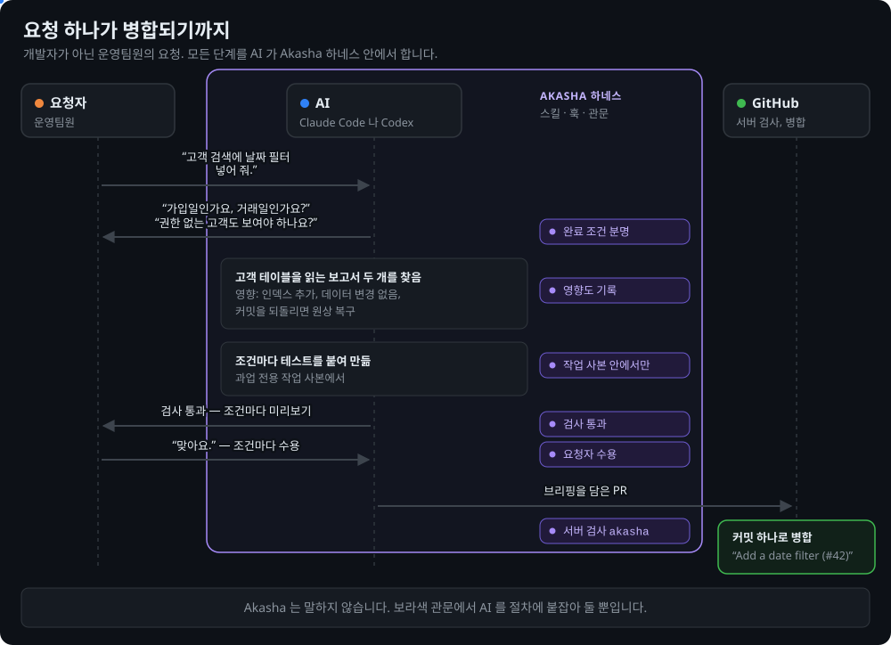

[English](README.md) | **한국어**

<div align="center">

◯ ───────────────────────────────── ◯


**A K A S H A**

◯ ───────────────────────────────── ◯

**Claude Code 와 Codex 를 위한 팀 하네스.**

팀원 누구나 평소 말로 기능을 요청합니다. 묻고, 만들고, 기술 판단을 하는 건 AI 입니다 —<br>
Akasha 는 그 AI 가 한 절차를 벗어나지 않게 붙잡아, 변경이 검사·수용을 거친 커밋 하나로 병합되게 합니다.


<a href="#라이선스"></a>


[빠른 시작](#빠른-시작) · [왜 Akasha 인가](#왜-akasha-인가) · [동작 방식](#동작-방식) · [누가 무엇을](#누가-무엇을) · [서버 규칙](#서버-규칙) · [문서](docs/README.md)

</div>

```
/plugin marketplace add Gruci/akasha-team-harness
/plugin install akasha@akasha
```

* * *

## 왜 Akasha 인가

Akasha 는 또 하나의 에이전트가 아닙니다. 이미 쓰는 AI 안에서 돕니다. 스킬이 팀 절차를 알려 주고, 훅이 절차를 깨는 동작을 막고, 단계 관문이 통과 전까지 과업을 붙잡습니다.

| | 없으면 | Akasha 가 있으면 |
|:--|:--|:--|
| 모호한 요청 | AI 가 다른 기능을 만듭니다 | 완료 조건이 분명해질 때까지 AI 가 묻습니다. 그 전엔 과업이 넘어가지 않습니다 |
| 기술 판단 | 개발자만 판단할 수 있습니다 | AI 가 판단하고 기록합니다. 사람은 무엇을, 어떻게 보이게, 어떻게 쓰게 할지만 정합니다 |
| 부작용 | 무엇을 더 건드리는지 아무도 모릅니다 | 기능·데이터·API·다른 과업에 대한 영향과 되돌리는 방법을 AI 가 기록합니다 |
| "다 됐어요" | 말뿐입니다 | 요청자가 미리보기로 써 보고 조건마다 수용합니다 |
| 몇 달 뒤 | 문제를 일으킨 변경을 못 찾습니다 | 변경마다 스쿼시 커밋 하나와 1분 브리핑 |
| 같은 기능, 두 사람 | 한 사람이 기다립니다 | 두 번째 과업이 첫 과업 위에 쌓입니다 |

* * *

## 빠른 시작

**1. 설치** — 팀원 각자, 한 번:

```
/plugin marketplace add Gruci/akasha-team-harness
/plugin install akasha@akasha
```

**2. 팀 레포를 엽니다.** 세션이 시작되면 Akasha 훅이 GitHub 에서 레포를 확인하고 결과를 AI 에게 넘깁니다.

| 훅이 찾은 것 | 일어나는 일 |
|:--|:--|
| 팀 규칙과 서버 규칙이 켜져 있음 | AI 가 바로 일을 시작합니다. 설정할 것 없음 |
| 아직 `akasha.toml` 이 없음 | **"Akasha 설정해줘"** 라고 말합니다. AI 가 관리자, 위험 폴더, 미리보기 명령을 묻습니다 |
| 서버 규칙이 꺼져 있음 | AI 가 알려 줍니다. 관리자가 한 번 승인하면 AI 가 팀 전체에 켭니다. 작업은 바로 시작하고, 인계만 기다립니다 |

**3. 기능을 요청합니다.**

```
고객 검색에 날짜 필터 넣어 줘.
```

> **참고:** Python 3.11 이상, git, GitHub 가 필요합니다. Codex 는 `pip install "git+https://github.com/Gruci/akasha-team-harness@v1.0.0"` 도 필요합니다.

* * *

## 얻는 것

<p align="center"></p>

* * *

## 동작 방식

<p align="center"></p>

작은 수정은 `small`, 버그는 `fix` 워크플로로 갑니다.

| 층 | 지키는 것 |
|:--|:--|
| 작업 중 | 훅이 모든 명령과 저장한 파일을 검사하고, 강제 push 처럼 되돌릴 수 없는 동작을 막습니다 |
| 인계 직전 | 통과 조건. 브리핑 검사도 포함합니다 |
| 서버 | 필수 검사 `akasha` 가 기본 브랜치의 규칙으로 돕니다 — PR 이 자기 규칙을 느슨하게 고칠 수 없습니다 |

* * *

## 누가 무엇을

| 누구 | 하는 일 | 할 필요 없는 일 |
|:--|:--|:--|
| **요청자** — 팀원 누구나 | 무엇을 만들지, 어떻게 보일지, 어떻게 쓸지 말하고 미리보기를 써 봅니다 | 코드 읽기, 기술 위험 판단 |
| **AI** — Claude Code 나 Codex | 구현, 범위, 영향도, 테스트, 브리핑, 제품 지도 | 사람에게 기술 질문하기 |
| **관리자** | 팀 규칙을 `akasha.toml` 에 한 번 적고, GitHub 설정 변경을 승인합니다 | 설정을 하나하나 손으로 맞추기 |

* * *

## 서버 규칙

GitHub 고유의 보호가 먼저입니다. Akasha 보조 워크플로는 GitHub 요금제에 그 기능이 없을 때만 빈자리를 채웁니다.

| 레포 | 지키는 것 |
|:--|:--|
| 공개 레포, 또는 GitHub Pro·Team·Enterprise 의 비공개 레포 | **GitHub** — 브랜치 보호, 필수 검사, 코드 오너, 자동 병합 |
| GitHub Free 의 비공개 레포 | **Akasha 보조 도구** — `akasha-merge` 가 검사 통과 뒤 병합하고, `akasha-watch` 가 검사를 건너뛴 변경을 되돌리고 이슈를 엽니다 |

설정은 GitHub 부터 시도하고, 어느 쪽이 적용되는지 `akasha.toml` 에 기록합니다. 요금제를 바꿨다면 설정을 다시 돌리면 됩니다.

> **참고:** GitHub 는 나쁜 변경을 병합 전에 막고, `akasha-watch` 는 들어온 직후에 되돌립니다. 관리자 push 와 강제 push 는 되돌리지 않고 알리기만 합니다.

* * *

## 보장하는 것과 보장하지 않는 것

| 보장하는 것 | 어떻게 |
|:--|:--|
| 필수 검사에 실패한 변경은 병합되지 않는다 | 서버 규칙. 설정이 설치하고, 세션을 시작할 때마다 다시 확인합니다 |
| 관리자 없이 팀 규칙이 바뀌지 않는다 | CODEOWNERS |
| 요청자가 수용하지 않은 것은 PR 로 넘어가지 않는다 | `feature`·`fix` 는 수용 기록이 있어야 인계합니다 |
| 모든 변경을 찾아서 되돌릴 수 있다 | 과업마다 브리핑을 담은 스쿼시 커밋 하나 |
| 과업끼리 덮어쓰지 않는다 | 과업마다 작업 사본 하나. 같은 기능의 과업은 쌓입니다 |

| 보장하지 않는 것 | 알아 둘 것 |
|:--|:--|
| 업무 로직의 정확성 | 그건 검수가 봅니다 |
| 데이터 되돌림 | 코드를 되돌려도 데이터는 돌아오지 않습니다. 되돌리는 방법은 영향도 기록에 있습니다 |
| 보안 경계 | 훅은 협조하는 AI 를 규칙 위에 두는 장치이지 샌드박스가 아닙니다 |
| 미리보기 환경 | 프로젝트가 제공합니다. AI 는 프로젝트의 명령으로 띄웁니다 |

* * *

## 자주 묻는 질문

| 질문 | 답 |
|:--|:--|
| 개발자가 없는 팀도 되나요? | 네. 기술 판단은 AI 가 하고, 실패한 변경은 서버 검사가 막습니다. 개발자가 있는 팀은 데이터나 권한에 사람 관문을 더할 수 있습니다 |
| 요청자가 터미널을 써야 하나요? | 아닙니다. 데스크톱 앱에서 말로 요청하고, 명령은 AI 가 실행합니다 |
| 두 사람이 같은 기능을 바꾸면요? | 두 번째 과업이 첫 과업 위에 쌓입니다. 첫 요청자가 수용한 동작을 바꾸면 Akasha 가 GitHub 에 그 사람 앞으로 알림을 남깁니다 |
| 변경은 어떻게 되돌리나요? | 기본 브랜치에서 그 커밋을 찾아 브리핑을 읽고, 그 커밋 하나를 되돌립니다 |
| GitHub Free 의 비공개 레포도 되나요? | 네. [서버 규칙](#서버-규칙)을 보세요 |

* * *

## 자세히

시작하는 데는 필요 없습니다 — AI 가 알아서 다룹니다.

<details>
<summary><b>안을 들여다보면 — 네 영역, 여덟 부품</b></summary>

| 영역 | 부품 | 하는 일 |
|:--|:--|:--|
| 작업 절차 | Core | 과업 상태, 단계 이동, PR 브리핑 |
| 작업 절차 | Workflow | `feature`·`fix`·`small` 의 단계와 통과 조건 |
| 작업 절차 | Skills · Context | 절차, 제품 지도, 팀의 결정 |
| 작업 절차 | Validators | 기계로 잴 수 있는 규칙을 검사로 |
| 작업 절차 | Team Config | `akasha.toml` 의 팀 규칙 |
| 에이전트 엔진 | Agent Engine | Claude Code 나 Codex 에 훅과 스킬을 연결 |
| 조정 | Coordinator | 공유 작업 보드, 겹침 검사, 과업 쌓기 |
| 인프라 관리 | Infra Manager | 서버 규칙을 Team Config 와 같게 유지 |

```
akasha/
├── core/          과업 상태, 단계, 위험, 작업 사본, PR 글
├── workflows/     feature · fix · small
├── validators/    가드, 비밀키 검사, 검사 실행기, 브리핑 검사, 언어 팩
├── coordinator/   공유 작업 보드, 겹침 검사, 미리보기 자원
├── infra/         GitHub 설정, merge·watch 보조 도구, 워크플로 틀
└── engine/        Claude Code·Codex 훅
skills/            akasha-setup · akasha-request · akasha-inspect · akasha-handover
```

</details>

* * *

## 변경 이력

| 버전 | 변경 내용 |
|:--|:--|
| **v1.0.0** | 첫 공개 릴리스. |

* * *

<div align="center">

*사람은 무엇을 만들지 정합니다. AI 는 어떻게 만들지 정합니다. 변경마다 분명한 기록이 하나 남습니다.*

## 라이선스

Daehyun Kim · [LinkedIn](https://www.linkedin.com/in/daehyun-kim-b00365176/) · MIT License

</div>
