[English](README.md) | **한국어**

<div align="center">

◯ ───────────────────────────────── ◯


**A K A S H A**

◯ ───────────────────────────────── ◯

**Claude Code 와 Codex 를 위한 가벼운 팀 하네스.**

사람은 평소 말로 변경을 요청하고,<br>
결과를 미리 보여 주는 시안을 승인합니다. 사람이 하는 일은 그것뿐입니다.

계획은 AI 가 쓰고, 두 번째 AI 가 그 계획을 검사하고,<br>
AI 가 만들고 검사해서 병합까지 합니다.


<a href="#라이선스"></a>


[빠른 시작](#빠른-시작) · [동작 방식](#동작-방식) · [여러 사람이 동시에](#여러-사람이-동시에) · [서버 규칙](#서버-규칙) · [문서](docs/README.md)

</div>

```
/plugin marketplace add Gruci/akasha-team-harness
/plugin install akasha@akasha
```

* * *

## 왜 Akasha 인가

이제 코드는 대부분 AI 가 쓰고, 코드를 읽는 사람은 적습니다.<br>
사람이 해야 할 확인은 맨 앞의 하나, "이게 우리가 원하는 것인가?" 입니다.<br>
Akasha 는 사람을 그 자리에 두고, 나머지는 모두 기계가 맡게 합니다.

| | 없으면 | Akasha 가 있으면 |
|:--|:--|:--|
| 사람이 확인하는 것 | 계획서, 또는 아무것도 없음 | 눈으로 보는 시안 하나 (목업이나 도식) |
| 계획 | 아무도 안 읽음 | 두 번째 AI 가 통과할 때까지 검사 |
| 승인 | AI 가 스스로 적을 수 있음 | 사람이 직접 친 말만, 그대로 기록 |
| 여러 사람 | 서로의 작업을 모름 | 열린 PR 이 곧 팀 보드 |
| "다 됐어요" | 말뿐 | GitHub 검사 통과 뒤 커밋 하나로 병합 |
| 몇 달 뒤 | 왜 이런지 아무도 모름 | 시안, 계획, 요약이 변경과 함께 남음 |

* * *

## 빠른 시작

**1. 관리자 — 레포마다 한 번**

플러그인을 설치하고 레포를 열고 **"Akasha 설정해줘"** 라고 말합니다. 그러면 AI 가

- 관리자, 위험한 부분, 검사 명령, 컴퓨터마다 깔 것, AI 가 읽을 팀 문서를 묻고
- 레포에 이미 있는 AI 작업 규칙을 Akasha 와 맞추고
- GitHub 을 설정하고, 설정 파일을 담은 PR 을 엽니다. 검사가 통과하면 병합합니다.

**2. 팀원 각자 — 한 번**

플러그인을 설치하고, `gh auth login` 으로 로그인하고, 레포를 엽니다.<br>
레포 설정이 플러그인을 이미 등록해 둡니다. 빠진 것이 있으면 AI 가 알려 줍니다.

**3. 변경을 요청합니다**

```
주문 목록을 CSV 파일로 내려받는 버튼을 넣어 줘.
```

AI 가 분명해질 때까지 묻고, 브라우저에 시안을 띄웁니다.<br>
이대로 좋으면 자기 말로 승인하고, 아니면 고칠 점을 말합니다.<br>
나머지는 AI 가 하고, 병합되면 알려 주고, 배포가 끝나면 다시 알려 줍니다.

> **참고:** Python 3.11 이상(훅이 `py -3`, `python3`, `python` 순서로 찾습니다), git, GitHub, GitHub 명령줄 `gh` 가
> 필요합니다. Codex 는 그 Python 에 `pip install "git+https://github.com/Gruci/akasha-team-harness@v1.0.0"` 도 필요합니다
> (Windows 에서는 `py -3 -m pip install …`).

* * *

## 동작 방식



과업마다 같은 여섯 단계를 거치고, 여러 과업이 동시에 이 단계를 지나갑니다.

| 단계 | 누가 | 관문 |
|:--|:--|:--|
| 1.&nbsp;요청 | 사람이 원하는 것을 말합니다 | — |
| 2.&nbsp;시안 | AI 가 시안을 만들고, 사람이 봅니다 | 사람이 대화창에서 승인 |
| 3.&nbsp;계획 | AI 가 조사와 계획을 씁니다 | 두 번째 AI 가 검사해 통과 |
| 4.&nbsp;구현 | AI 가 자기 작업 폴더에서 고칩니다 | 2·3단계 전에는 못 고침 |
| 5.&nbsp;검사 | 팀의 검사가 돕니다 | 필수 검사가 모두 통과 |
| 6.&nbsp;병합 | PR 을 최신으로 맞추고 병합합니다 | GitHub 에서 검사 통과 |

훅이 AI 를 이 단계 위에 붙잡아 둡니다.
- 승인에 쓸 사람의 메시지를 남기고, 두 번째 AI 의 계획 판정을 기록합니다.
- 관문을 지나기 전에는 코드를 고치지 못하게 막습니다.
- 공유 폴더나, Akasha 밖에서 만든 작업 폴더에서 직접 고치는 것을 막습니다.
- 강제 push, 기본 브랜치로의 push, 손으로 하는 병합을 막습니다.
- 다른 폴더에서 시작한 대화가 이 레포를 고치거나 `git -C` 로 다뤄도 같은 규칙이 적용됩니다.

자세한 내용은 [동작 방식](docs/how-it-works.md)에 있습니다.

* * *

## 여러 사람이 동시에

어느 팀의 누구든 각자 자기 과업을 동시에 진행합니다.

| 상황 | 일어나는 일 |
|:--|:--|
| 열린 과업과 같은 파일을 계획함 | 시작할 때 보드가 그 과업과 담당자를 보여 줍니다 |
| 여러 과업이 같은 파일을 고침 | 각 AI 가 바로 알고, 뒤 과업이 앞 변경을 받습니다 |
| 여러 과업이 한꺼번에 준비됨 | 하나씩 병합하고, 뒤 과업은 최신으로 맞춥니다 |
| 멈춘 과업을 다른 사람이 이어 함 | `handoff` 로 넘기고, `resume` 으로 이어 갑니다 |
| 이미 쓰인 과업 이름 | 시작이 거절하고, AI 가 다른 이름을 고릅니다 |
| AI 가 막힘 | PR 에서 관리자에게 도움을 청합니다 |

* * *

## 누가 무엇을

팀의 역할은 관리자와 팀원, 둘뿐입니다.

| 누구 | 하는 일 | 안 해도 되는 일 |
|:--|:--|:--|
| **관리자** | Akasha 와 DB, 배포를 설정하고 유지보수합니다 | 과업 검토 |
| **팀원** | 무엇을 만들지 말하고, 시안을 승인합니다 | 코드 읽기, 계획서 검토 |

각자의 AI 설정(`.claude/settings.local.json`, `CLAUDE.local.md`)은 git 에 올리지 않습니다.<br>
그래서 하네스를 사람마다 자유롭게 바꿔 쓸 수 있습니다.

* * *

## 서버 규칙

| 레포 | 나쁜 병합을 막는 것 |
|:--|:--|
| 공개 레포, 또는 유료 GitHub 의 비공개 레포 | **GitHub**: 브랜치 보호와 필수 검사 |
| GitHub Free 의 비공개 레포 | **Akasha**: 검사가 통과한 뒤에만 병합 |

- GitHub Free 에서는 감시 워크플로가 규칙을 건너뛴 변경도 알립니다.
- 설정은 GitHub 부터 시도하고, 어느 쪽이 적용되는지 기록합니다.
- 랜딩마다 GitHub 에 다시 묻고, 보호가 약하면 Akasha 가 직접 병합합니다.
- 병합은 그 사람의 계정으로 하므로, 배포처럼 병합 뒤 워크플로가 시작됩니다.
- `[deploy] workflow` 를 적어 두면 배포가 끝날 때까지 기다렸다 알려 줍니다.

* * *

## 보장하는 것과 보장하지 않는 것

| 보장하는 것 | 어떻게 |
|:--|:--|
| 승인은 사람의 말에서 나온다 | 시안을 띄운 대화에서 사람이 친 말만 받습니다 |
| 코드는 승인과 계획 검사를 기다린다 | 둘 다 지나기 전에는 코드 편집을 막습니다 |
| 검사에 실패한 변경은 병합되지 않는다 | GitHub 에서 필수 검사가 실제로 통과해야 합니다 |
| 위험한 부분은 관리자만 고친다 | 팀원의 과업은 DB 와 배포에서 멈춥니다 |
| 모든 변경을 찾아 되돌릴 수 있다 | 요약과 기록을 담은 스쿼시 커밋 하나 |

| 보장하지 않는 것 | 알아 둘 것 |
|:--|:--|
| 샌드박스 | 훅은 협조하는 AI 를 단계 위에 둘 뿐입니다 |
| 승인 메시지의 뜻 | AI 가 판단하고, PR 에 그 말이 그대로 남습니다 |
| GitHub Free 의 병합 전 보호 | 손으로 병합할 수 있고, 감시가 알립니다 |
| 업무 로직의 정확성 | 시안, 계획 검사, 팀의 검사가 봅니다 |
| 데이터 | 코드를 되돌려도 데이터는 그대로. DB 는 위험 경로로 |

* * *

## 더 보기

| | |
|:--|:--|
| [동작 방식](docs/how-it-works.md) | 단계, 관문, 랜딩, Akasha 가 데이터를 두는 곳 |
| [팀 설정하기](docs/admin.md) | 설정, 서버 규칙, 자체 CI 가 있는 팀, 회고 |
| [팀 설정 파일](docs/team-config.md) | `akasha.toml` 의 모든 키 |
| [명령](docs/commands.md) | Akasha 의 모든 명령 |

* * *

## 변경 이력

| 버전 | 변경 내용 |
|:--|:--|
| **v1.0.0** | 첫 공개 릴리스. |

* * *

<div align="center">

*사람은 눈으로 보는 것 위에서, 한 번, 무엇을 만들지 정합니다. 어떻게 만들지는 AI 가 정합니다. 변경마다 분명한 기록이 하나 남습니다.*

## 라이선스

Daehyun Kim · [LinkedIn](https://www.linkedin.com/in/daehyun-kim-b00365176/) · MIT License

</div>
