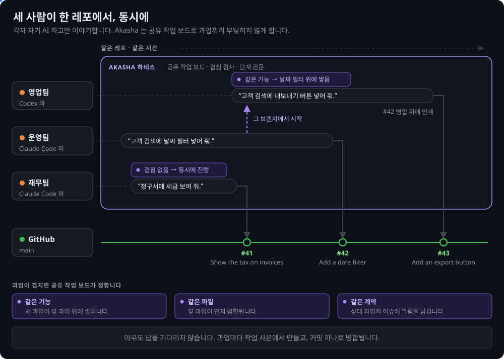
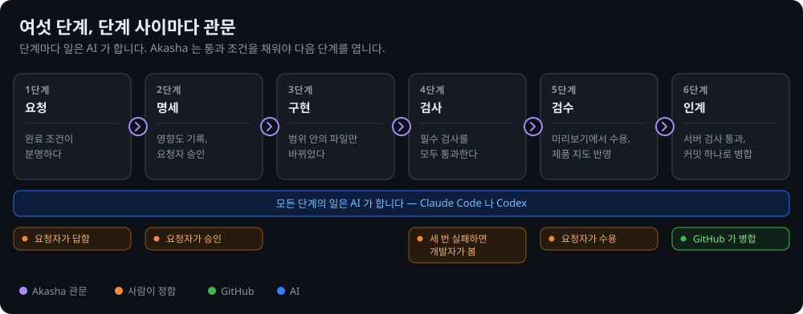

[English](README.md) | **한국어**

<div align="center">

◯ ───────────────────────────────── ◯


**A K A S H A**

◯ ───────────────────────────────── ◯

**Claude Code 와 Codex 를 위한 팀 하네스.**

팀원 누구나 평소 말로 기능을 요청합니다. 묻고, 만들고, 기술 판단을 하는 건 AI 입니다 —<br>
Akasha 는 그 AI 가 한 절차를 벗어나지 않게 붙잡아, 변경이 검사·수용을 거친 커밋 하나로 병합되게 합니다.


<a href="#라이선스"></a>


[빠른 시작](#빠른-시작) · [왜 Akasha 인가](#왜-akasha-인가) · [동작 방식](#동작-방식) · [누가 무엇을](#누가-무엇을) · [서버 규칙](#서버-규칙) · [문서](docs/README.md)

</div>

```
/plugin marketplace add Gruci/akasha-team-harness
/plugin install akasha@akasha
```

* * *

## 왜 Akasha 인가

Akasha 는 또 하나의 에이전트가 아닙니다. 이미 쓰는 AI 안에서 돕니다. 스킬이 팀 절차를 알려 주고, 훅이 절차를 깨는 동작을 막고, 단계 관문이 통과 전까지 과업을 붙잡습니다.

| | 없으면 | Akasha 가 있으면 |
|:--|:--|:--|
| 팀 규칙 | 사람마다 AI 가 제각각 일합니다 | 관리자가 `akasha.toml` 에 한 번 적습니다.<br>팀의 모든 AI 와 서버 검사가 그 규칙을 따릅니다 |
| 모호한 요청 | AI 가 다른 기능을 만듭니다 | 완료 조건이 분명해질 때까지 AI 가 묻습니다.<br>그 전엔 과업이 넘어가지 않습니다 |
| 기술 판단 | 개발자만 판단할 수 있습니다 | AI 가 판단하고 기록합니다.<br>사람은 무엇을, 어떻게 보이게, 어떻게 쓰게 할지만 정합니다 |
| 부작용 | 무엇을 더 건드리는지 아무도 모릅니다 | 기능·데이터·API·다른 과업에 대한 영향을 AI 가 기록합니다.<br>되돌리는 방법도 기록합니다 |
| 승인 | AI 가 누구 이름으로든 "승인됨"을 적습니다 | 사람마다 자기 GitHub 계정의 댓글로 승인합니다 |
| "다 됐어요" | 말뿐입니다 | 요청자가 미리보기로 써 보고 조건마다 수용합니다 |
| 몇 달 뒤 | 문제를 일으킨 변경을 못 찾습니다 | 변경마다 스쿼시 커밋 하나와 1분 브리핑 |
| 같은 기능, 두 사람 | 한 사람이 기다립니다 | 두 번째 과업이 첫 과업 위에 쌓입니다 |
| 여러 컴퓨터 | 작업이 시작한 컴퓨터에만 남습니다 | 과업은 GitHub 이슈에 있습니다.<br>누구든 다른 컴퓨터에서 넘겨받을 수 있습니다 |

* * *

## 빠른 시작

**1. 관리자 — 레포마다 한 번**

플러그인을 설치하고, 레포를 열고, **"Akasha 설정해줘"** 라고 말합니다.

```
/plugin marketplace add Gruci/akasha-team-harness
/plugin install akasha@akasha
```

AI 가 다음을 묻습니다.

- 팀 규칙을 관리할 관리자
- 위험하게 다룰 폴더와, 그 폴더의 변경을 승인할 사람
- 프로젝트를 설치하고, 테스트하고, 미리보기로 띄우는 명령

그다음 레포 관리자인 `gh` 계정으로 GitHub 설정 변경을 승인합니다. AI 가 서버 규칙을 켜고, 설정 파일을 담은 PR 을 엽니다. 그 PR 을 병합합니다.

마지막으로 Akasha 의 GitHub 앱을 만듭니다. 단계는 AI 가 알려 줍니다. 앱이 있으면 과업의 PR 이 기본 브랜치에 맞춰 늘 최신으로 유지됩니다.

**2. 팀원 각자 — 한 번**

같은 플러그인을 설치하고 내 GitHub 계정으로 로그인합니다: `gh auth login`. 그다음 팀 레포를 엽니다. 세션이 시작되면 Akasha 훅이 레포를 확인하고 결과를 AI 에게 넘깁니다.

| 훅이 찾은 것 | 일어나는 일 |
|:--|:--|
| 아직 설정 전 | AI 가 1단계의 설정을 안내합니다 |
| GitHub 에는 설정됐지만 내 사본에는 없음 | AI 가 기본 브랜치를 pull 하라고 알려 줍니다 |
| 서버 규칙이 꺼져 있음 | AI 가 알려 줍니다. 관리자가 한 번 승인하면 AI 가 켭니다.<br>작업은 바로 시작하고, 인계만 기다립니다 |
| 준비됨 | AI 가 바로 일을 시작합니다.<br>내 과업과 그 새 댓글도 보여 줍니다 |

**3. 기능을 요청합니다**

```
고객 검색에 날짜 필터 넣어 줘.
```

> **참고:** Python 3.11 이상, git, GitHub, GitHub 명령줄 `gh` 가 필요합니다. 팀원마다 레포에 댓글을 달 수 있는 GitHub 계정이 필요합니다. Codex 는 `pip install "git+https://github.com/Gruci/akasha-team-harness@v1.0.0"` 도 필요합니다.

* * *

## 얻는 것

<p align="center"></p>

관리자가 레포를 한 번 설정해 두었습니다. 그 뒤 같은 날 오후, 세 사람이 변경을 요청합니다. 각자 자기 AI 하고만 이야기합니다. 셋 다 개발자가 아닙니다.

| 누가 | 요청 | 공유 작업 보드 |
|:--|:--|:--|
| 운영팀 | "고객 검색에 날짜 필터 넣어 줘." | 새 과업. 작업 사본이 따로 생깁니다 |
| 재무팀 | "청구서에 세금 보여 줘." | 날짜 필터와 겹치지 않습니다.<br>둘이 동시에 진행합니다 |
| 영업팀, 조금 뒤에 | "고객 검색에 내보내기 버튼 넣어 줘." | 날짜 필터와 같은 기능입니다.<br>그 브랜치에서 시작합니다.<br>날짜 필터가 병합된 뒤에 인계합니다 |

GitHub 가 커밋 세 개를 차례로 병합합니다 — `#41 Show the tax on invoices`, `#42 Add a date filter`, `#43 Add an export button`. 커밋마다 브리핑이 따로 붙습니다. 아무도 다른 사람의 답을 기다리지 않았습니다.

두 과업이 겹치면 이 규칙이 적용됩니다.

| 겹침 | 일어나는 일 |
|:--|:--|
| 같은 기능 | 새 과업이 앞 과업 위에 쌓입니다 |
| 같은 파일 | 두 과업 모두 진행합니다.<br>뒤에 병합되는 과업이 앞 변경을 받아들입니다 |
| 같은 계약 | 상대 과업의 이슈에 알림이 남습니다.<br>GitHub 가 그 이슈를 지켜보는 사람에게 알립니다 |

과업마다 이슈, 기능의 지도 파일, 미리보기 포트와 데이터베이스를 따로 갖습니다.

과업은 다른 사람이나 다른 컴퓨터로 옮길 수도 있습니다.

| 누가 | 말하기 | 일어나는 일 |
|:--|:--|:--|
| 과업을 맡은 사람 | "과업 넘겨줘." | AI 가 작업을 GitHub 에 저장하고 과업을 풉니다.<br>비밀키나 범위 밖 파일이 있으면 넘기지 않습니다 |
| 다른 사람, 또는 다른 컴퓨터의 같은 사람 | "과업 넘겨받아 줘." | AI 가 저장된 작업으로 작업 사본을 만듭니다.<br>이제 그 사람이 과업을 맡습니다 |

과업은 맡은 사람만 바꾸고, 넘겨줄 때 강제 push 를 하지 않습니다. 예전 작업이 새 작업을 덮어쓰지 못합니다.

* * *

## 동작 방식

<p align="center"></p>

| 단계 | 통과 조건 | AI 말고 누가 |
|:--|:--|:--|
| 첫 과업 전 | 팀 규칙이 `akasha.toml` 에 있다.<br>첫 인계 전에 서버 규칙이 켜져 있다 | 관리자, 한 번 |
| 1. 요청 | 완료 조건이 분명하다 | 요청자가 질문에 답합니다 |
| 2. 명세 | 영향도가 기록됐다.<br>요청자가 지금의 명세를 승인한다 | 요청자가 승인합니다 |
| 3. 구현 | 범위 안의 파일만 바뀌었다 | — |
| 4. 검사 | 필수 검사를 모두 통과한다.<br>파일이 바뀌지 않은 검사는 돌지 않는다 | 세 번 고쳐도 안 되면 개발자 |
| 5. 검수 | 요청자가 미리보기에서 수용한다.<br>기능의 지도 파일에 변경이 반영됐다 | 요청자가 수용합니다 |
| 6. 인계 | 서버 검사를 통과한다.<br>브리핑과 함께 커밋 하나로 병합된다 | GitHub 가 병합합니다 |

작은 수정은 `small`, 버그는 `fix` 워크플로로 갑니다.

사람의 결정은 그 사람 자기 GitHub 계정으로 과업 이슈에 다는 댓글입니다.

| 결정 | 댓글 | 쓰는 사람 |
|:--|:--|:--|
| 명세 승인 | `/approve spec r<N>` | 요청자 |
| 관문이 있는 위험도 승인 | `/approve risk <위험도>` | 관문 역할이 있는 사람 |
| 조건 수용·거절 | `/accept <번호> r<N>` 또는 `/reject <번호> r<N> <이유>` | 요청자 |
| 멈춘 과업 다시 열기 | `/resume` | 개발자 |
| 요청 철회 | `/cancel <이유>` | 요청자나 개발자 |

`r<N>` 은 명세의 판 번호입니다. 옛 판의 댓글과 고친 댓글은 세지 않습니다. 그 사람이 AI 의 컴퓨터 앞에 있으면, AI 가 그 사람의 `gh` 계정으로 댓글을 답니다. 다른 사람은 GitHub 에서, 휴대폰으로도 댓글을 답니다.

| 층 | 지키는 것 |
|:--|:--|
| 작업 중 | 훅이 모든 명령과 저장한 파일을 검사합니다.<br>강제 push 처럼 되돌릴 수 없는 동작을 막습니다.<br>AI 가 `gh` 로 다는 결정 댓글도 막습니다 |
| 인계 직전 | 통과 조건. 브리핑 검사도 포함합니다 |
| 서버 | 필수 검사 `akasha` 가 기본 브랜치의 규칙으로 돕니다.<br>PR 이 자기 규칙을 느슨하게 고칠 수 없습니다 |

* * *

## 누가 무엇을

| 누구 | 하는 일 | 할 필요 없는 일 |
|:--|:--|:--|
| **관리자** | 레포를 한 번 설정합니다: `akasha.toml` 의 팀 규칙, GitHub 설정, GitHub 앱 | 설정을 하나하나 손으로 맞추기 |
| **요청자** — 팀원 누구나 | 무엇을 만들지, 어떻게 보일지, 어떻게 쓸지 말합니다.<br>명세 승인과 결과 수용을 댓글로 합니다 | 코드 읽기, 기술 위험 판단 |
| **개발자** — 선택 | `[approval]` 에 관문이 있으면 그 위험도를 승인합니다.<br>세 번 실패한 과업을 다시 엽니다 | 과업마다 지켜보기 |

* * *

## 서버 규칙

GitHub 고유의 보호가 먼저입니다. Akasha 보조 워크플로는 GitHub 요금제에 그 기능이 없을 때만 병합하고 되돌립니다.

| 레포 | 지키는 것 |
|:--|:--|
| 공개 레포, 또는 GitHub Pro·Team·Enterprise 의 비공개 레포 | **GitHub** — 브랜치 보호, 필수 검사, 코드 오너, 자동 병합 |
| GitHub Free 의 비공개 레포 | **Akasha 보조 도구** — `akasha-merge` 가 검사 통과와 코드 오너 승인 뒤 병합합니다.<br>`akasha-watch` 가 검사를 건너뛴 변경을 되돌리고 이슈를 엽니다 |

설정은 GitHub 부터 시도하고, 어느 쪽이 적용되는지 `akasha.toml` 에 기록합니다. 요금제를 바꿨다면 설정을 다시 돌리면 됩니다.

GitHub 앱이 있으면, 기본 브랜치가 바뀔 때마다 보조 도구가 PR 을 최신으로 맞춥니다. 두 경우 모두 같습니다. 그래서 동시에 인계한 과업도 차례로 모두 병합되고, 병합마다 배포 같은 다른 워크플로도 시작됩니다.

PR 의 서버 검사가 실패하면 보조 도구가 PR 과 과업 이슈에 댓글을 답니다. 앱이 있으면 PR 이 기본 브랜치와 충돌할 때도 댓글을 답니다. AI 가 이 댓글을 과업을 맡은 사람에게 보여 줍니다.

서버 검사는 `akasha.toml` 의 `[ci]` 에 적은 실행 기계와 Python 으로 돕니다. 기본값은 `ubuntu-latest` 와 Python 3.12 입니다.

> **참고:** GitHub 는 나쁜 변경을 병합 전에 막고, `akasha-watch` 는 들어온 직후에 되돌립니다. 관리자 push 와 강제 push 는 되돌리지 않고 알리기만 합니다.

* * *

## 보장하는 것과 보장하지 않는 것

| 보장하는 것 | 어떻게 |
|:--|:--|
| 관리자 없이 팀 규칙이 바뀌지 않는다 | CODEOWNERS |
| 필수 검사에 실패한 변경은 병합되지 않는다 | 서버 규칙.<br>설정이 설치하고, 세션을 시작할 때마다 다시 확인합니다 |
| 결정은 결정하는 사람에게서 온다 | 그 사람 GitHub 계정의 댓글만 셉니다.<br>AI 의 결정 댓글은 가드가 막습니다 |
| 요청자가 수용하지 않은 것은 PR 로 넘어가지 않는다 | `feature`·`fix` 는 요청자가 수용한 뒤에야 인계합니다 |
| 모든 변경을 찾아서 되돌릴 수 있다 | 과업마다 브리핑을 담은 스쿼시 커밋 하나 |
| 과업끼리 덮어쓰지 않는다 | 과업마다 작업 사본 하나, 맡은 사람 한 명.<br>같은 기능의 과업은 쌓입니다 |

| 보장하지 않는 것 | 알아 둘 것 |
|:--|:--|
| 미리보기 환경 | 프로젝트가 제공합니다. 관리자가 설정 때 명령을 알려 줍니다.<br>과업마다 포트가 따로 있고, AI 가 미리보기를 띄웁니다 |
| 다른 컴퓨터에서 보는 미리보기 | 미리보기는 작업 사본이 있는 컴퓨터에서 돕니다.<br>다른 컴퓨터의 요청자는 그 미리보기에 접근할 수 있어야 합니다 |
| 보안 경계 | 훅은 협조하는 AI 를 규칙 위에 두는 장치입니다.<br>샌드박스가 아닙니다 |
| 과업 이슈의 본문 | 쓰기 권한이 있는 사람은 GitHub 에서 고칠 수 있습니다.<br>쓰기 권한은 팀이 믿는 사람에게만 주세요 |
| 업무 로직의 정확성 | 그건 검수가 봅니다 |
| 데이터 되돌림 | 코드를 되돌려도 데이터는 돌아오지 않습니다.<br>되돌리는 방법은 영향도 기록에 있습니다 |

* * *

## 자주 묻는 질문

| 질문 | 답 |
|:--|:--|
| 누가 Akasha 를 설정할 수 있나요? | 누구나 "Akasha 설정해줘" 라고 말할 수 있습니다.<br>GitHub 설정 승인은 관리자만 할 수 있습니다 |
| GitHub Free 의 비공개 레포도 되나요? | 네. [서버 규칙](#서버-규칙)을 보세요 |
| 개발자가 없는 팀도 되나요? | 네. 기술 판단은 AI 가 하고, 실패한 변경은 서버 검사가 막습니다.<br>개발자가 있는 팀은 데이터나 권한에 사람 관문을 더할 수 있습니다 |
| 요청자가 터미널을 써야 하나요? | `gh auth login` 할 때 한 번만 씁니다.<br>그 뒤엔 데스크톱 앱에서 말로 요청하고, 명령은 AI 가 실행합니다 |
| 요청자마다 GitHub 계정이 있어야 하나요? | 네. 결정마다 그 사람 계정의 댓글입니다.<br>비공개 레포라면 그 계정에 레포 권한이 있어야 합니다 |
| 요청자가 휴대폰으로 승인할 수 있나요? | 네. 과업 이슈에 나온 댓글을 달면 됩니다.<br>수용하려면 미리보기를 볼 수 있어야 합니다 |
| 다른 컴퓨터에서 과업을 이어 할 수 있나요? | 네. 처음 컴퓨터에서 "과업 넘겨줘", 다른 컴퓨터에서 "과업 넘겨받아 줘" 라고 말합니다 |
| 두 사람이 같은 기능을 바꾸면요? | 두 번째 과업이 첫 과업 위에 쌓입니다.<br>첫 요청자가 수용한 동작을 바꾸면 그 사람이 GitHub 에서 알림을 받습니다 |
| 프론트엔드와 백엔드가 한 레포에 있으면요? | `[checks.<이름>]` 으로 부분마다 검사를 따로 두고, 폴더와 파일을 적습니다.<br>검사는 자기 파일이 바뀔 때만 돕니다 |
| 레포에 이미 자체 훅이나 브랜치 이름 규칙이 있으면요? | Akasha 는 Codex 의 다른 훅과 `AGENTS.md` 의 다른 글을 그대로 둡니다.<br>`[work]` 로 작업 폴더와 브랜치 접두어를 정합니다 |
| 변경은 어떻게 되돌리나요? | 기본 브랜치에서 그 커밋을 찾아 브리핑을 읽습니다.<br>그 커밋 하나를 되돌립니다 |

* * *

## 자세히

시작하는 데는 필요 없습니다 — AI 가 알아서 다룹니다.

<details>
<summary><b>팀 설정 — <code>akasha.toml</code> 의 섹션</b></summary>

`akasha.toml` 은 관리자가 관리합니다. 과업은 이 파일을 기본 브랜치에서 읽으므로, 모든 컴퓨터가 같은 규칙을 씁니다. 키마다의 설명은 [팀 설정](docs/team-config.md)에 있습니다.

| 섹션 | 담는 것 |
|:--|:--|
| `[roles]` | 개발자와 관리자의 GitHub 이름 |
| `[risk]` | 위험도가 높은 코드와 중간인 코드의 파일 패턴 |
| `[approval]` | 위험도마다의 사람 관문. 기본은 없음 |
| `[checks]` | 필수 검사와 설치 명령.<br>`[checks.<이름>]` 은 검사 하나의 명령, 폴더, 파일 |
| `[preview]` | 미리보기 명령, 데이터베이스 이름, 과업 데이터베이스를 만들고 지우는 명령 |
| `[contracts]` | 공개 계약. 예를 들면 다른 팀이 쓰는 API |
| `[workflows]` | 새 요청이 쓸 수 있는 워크플로 |
| `[server]` | 서버 규칙을 누가 지키는지: GitHub 또는 Akasha 보조 도구. 설정이 적습니다 |
| `[ci]` | 서버 검사의 실행 기계와 Python |
| `[context]` | 지도 파일 폴더. 기본값은 `.akasha/context/map` |
| `[work]` | 작업 사본 폴더와 과업 브랜치 접두어 |

</details>

<details>
<summary><b>Akasha 가 단계를 멈출 때</b></summary>

AI 가 메시지마다 쉬운 말로 알려 줍니다. 자주 나오는 것은 이렇습니다.

| Akasha 가 말하는 것 | 할 일 |
|:--|:--|
| 기본 브랜치의 워크플로 파일이 Akasha 가 만드는 파일과 다르다 | 관리자가 다시 "Akasha 설정해줘" 라고 하고 그 PR 을 병합합니다 |
| 공유 작업 보드나 내 GitHub 이름을 읽을 수 없다 | GitHub 에 로그인합니다: `gh auth login`. 그다음 그 단계를 다시 합니다 |
| 기본 브랜치를 가져올 수 없다 | 네트워크와 git 의 GitHub 로그인을 확인합니다 |
| 다른 사람이 과업을 맡고 있다 | 그 사람에게 과업을 넘겨 달라고 합니다. 그다음 넘겨받습니다 |
| 다른 컴퓨터가 과업을 바꿨다 | 그 단계를 다시 합니다 |
| 사람이 댓글을 달아야 한다 | 그 사람이 자기 GitHub 계정으로, Akasha 가 보여 주는 댓글을 답니다 |
| 요청자에게 비공개 레포 권한이 없다 | 관리자가 요청자에게 권한을 줍니다 |
| 앞 과업이 취소됐다 | AI 가 그 위에 쌓는 것을 멈추고, 과업에 필요 없는 변경을 뺍니다 |

</details>

<details>
<summary><b>안을 들여다보면 — 네 영역, 여덟 부품</b></summary>

| 영역 | 부품 | 하는 일 |
|:--|:--|:--|
| 작업 절차 | Core | 과업 상태, 단계 이동, PR 브리핑 |
| 작업 절차 | Workflow | `feature`·`fix`·`small` 의 단계와 통과 조건 |
| 작업 절차 | Skills · Context | 절차, 기능별 지도 파일, 팀의 결정 |
| 작업 절차 | Validators | 기계로 잴 수 있는 규칙을 검사로 |
| 작업 절차 | Team Config | `akasha.toml` 의 팀 규칙 |
| 에이전트 엔진 | Agent Engine | Claude Code 나 Codex 에 훅과 스킬을 연결 |
| 조정 | Coordinator | 공유 작업 보드, 넘겨주기·넘겨받기, 겹침 검사, 과업 쌓기, 미리보기 자원 |
| 인프라 관리 | Infra Manager | 서버 규칙을 Team Config 와 같게 유지. merge·watch·update 보조 도구 |

```
akasha/
├── core/          과업 상태, 단계, 위험, 작업 사본, PR 글
├── workflows/     feature · fix · small
├── validators/    가드, 비밀키 검사, 검사 실행기, 브리핑 검사, 언어 팩
├── coordinator/   공유 작업 보드, 겹침 검사, 미리보기 자원
├── infra/         GitHub 설정, merge·watch·update 보조 도구, 워크플로 틀
└── engine/        Claude Code·Codex 훅
skills/            akasha-setup · akasha-request · akasha-inspect · akasha-handover
```

</details>

* * *

## 변경 이력

| 버전 | 변경 내용 |
|:--|:--|
| **v1.0.0** | 첫 공개 릴리스. |

* * *

<div align="center">

*사람은 무엇을 만들지 정합니다. AI 는 어떻게 만들지 정합니다. 변경마다 분명한 기록이 하나 남습니다.*

## 라이선스

Daehyun Kim · [LinkedIn](https://www.linkedin.com/in/daehyun-kim-b00365176/) · MIT License

</div>
