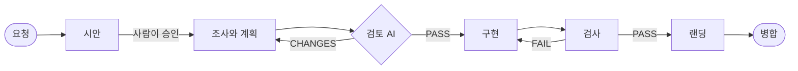

[English](README.md) | **한국어**

<div align="center">

◯ ───────────────────────────────── ◯


**A K A S H A**

◯ ───────────────────────────────── ◯

**Claude Code 와 Codex 를 위한 가벼운 팀 하네스.**

사람은 평소 말로 변경을 요청하고, 그 결과를 미리 보여 주는 시안을 승인합니다. 사람이 하는 일은 그것뿐입니다.<br>
계획은 AI 가 쓰고, 다른 AI 가 그 계획을 검토하고, AI 가 만들고 검사해서 병합까지 합니다.


<a href="#라이선스"></a>


[빠른 시작](#빠른-시작) · [동작 방식](#동작-방식) · [여러 사람이 동시에](#여러-사람이-동시에) · [서버 규칙](#서버-규칙) · [문서](docs/README.md)

</div>

```
/plugin marketplace add Gruci/akasha-team-harness
/plugin install akasha@akasha
```

* * *

## 왜 Akasha 인가

이제 코드는 대부분 AI 가 쓰고, 코드를 읽는 사람은 적습니다. 여전히 사람이 해야 하는 확인은 맨 앞의 하나입니다.
"이게 우리가 원하는 것인가?" Akasha 는 사람을 그 자리에 두고, 나머지는 모두 기계가 맡게 합니다.

| | 없으면 | Akasha 가 있으면 |
|:--|:--|:--|
| 사람이 확인하는 것 | 기술 문서인 계획서, 또는 아무것도 없음 | 눈으로 보는 시안 하나. 화면이면 목업, 화면이 없으면 흐름과 데이터 도식 |
| 계획 | 아무도 안 읽거나, 개발자 한 명이 전부 읽음 | 다른 AI 가 시안과 코드에 비춰 통과할 때까지 검토 |
| 승인 | AI 가 "승인됨"이라고 적을 수 있음 | 사람이 직접 입력한 "승인"(같은 뜻의 짧은 말 몇 가지)만, 시안을 띄운 그 대화에서, 그 사람이 본 그 시안에만 승인이 기록됨 |
| 여러 사람 | 각자의 AI 가 제각각 일하고, 서로를 모름 | 열린 PR 이 곧 팀 보드. 과업을 시작할 때와 파일을 고칠 때마다 겹침을 알림 |
| "다 됐어요" | 말뿐 | 팀의 검사가 GitHub 에서 통과하고, 기록과 함께 커밋 하나로 병합 |
| 몇 달 뒤 | 왜 이렇게 생겼는지 아무도 모름 | 시안, 계획, 요약이 변경과 함께 남음 |

* * *

## 빠른 시작

**1. 관리자 — 레포마다 한 번**

플러그인을 설치하고 레포를 열고 **"Akasha 설정해줘"** 라고 말합니다. AI 가 몇 가지를 묻습니다. 관리자가 누구인지,
위험한 경로는 어디인지, 변경을 검사하는 명령은 무엇인지, 컴퓨터마다 무엇을 깔아야 하는지, AI 가 읽어야 할 팀 문서는
무엇인지입니다. 레포에 이미 있는 AI 작업 규칙을 Akasha 와 맞추고, GitHub 을 설정하고, 설정 파일을 담은 PR 을 엽니다.
그 PR 의 검사가 통과하면 병합합니다.

**2. 팀원 각자 — 한 번**

플러그인을 설치하고, `gh auth login` 으로 로그인하고, 레포를 엽니다. 레포 설정이 플러그인을 이미 등록해 둡니다.
빠진 것이 있으면 AI 가 무엇이 빠졌고 어떻게 채우는지 알려 줍니다.

**3. 변경을 요청합니다**

```
펀드 화면의 합계 옆에 평균도 보여 줘.
```

AI 가 분명해질 때까지 묻고, 브라우저에 시안을 띄웁니다. **"승인"** 이라고 직접 입력하거나, 고칠 점을 말합니다.
나머지는 AI 가 하고, 병합되면 알려 주고, 배포까지 끝나 실제로 반영되면 다시 알려 줍니다.

> **참고:** Python 3.11 이상(훅이 `py -3`, `python3`, `python` 순서로 찾습니다), git, GitHub, GitHub 명령줄 `gh` 가
> 필요합니다. Codex 는 그 Python 에 `pip install "git+https://github.com/Gruci/akasha-team-harness@v1.0.0"` 도 필요합니다.

* * *

## 동작 방식



| 단계 | 누가 | 관문 |
|:--|:--|:--|
| 1. 요청 | 사람이 원하는 것을 말합니다 | — |
| 2. 시안 | AI 가 HTML 시안을 만들고, 사람이 봅니다 | 사람이 대화창에서 승인합니다 |
| 3. 계획 | AI 가 조사와 계획을 씁니다 | akasha-reviewer 에이전트가 계획을 통과시킵니다 |
| 4. 구현 | AI 가 자기 작업 폴더에서 코드를 고칩니다 | 2·3단계 전에는 코드를 고칠 수 없습니다 |
| 5. 검사 | 팀의 검사가 돕니다 | 필수 검사가 모두 통과합니다 |
| 6. 랜딩 | PR 이 준비되고, 최신으로 맞춰지고, 병합됩니다 | GitHub 에서 검사가 통과합니다. 위험한 경로는 리뷰어가, 팀 규칙 파일은 관리자가 승인해야 합니다 |

훅이 AI 를 이 단계 위에 붙잡아 둡니다.
- 사람의 메시지에서 승인을 기록하고, 검토 AI(akasha-reviewer)의 판정만 기록합니다.
- 관문을 지나기 전에는 코드를 고치지 못하게 막습니다.
- 공유 폴더나, Akasha 밖에서 만든 작업 폴더에서 직접 고치는 것을 막습니다.
- 강제 push, 기본 브랜치로의 push, 손으로 하는 병합을 막습니다.
- 다른 폴더에서 시작한 대화가 이 레포를 고치거나 `git -C` 로 다뤄도 같은 규칙이 적용됩니다.

자세한 내용은 [동작 방식](docs/how-it-works.md)에 있습니다.

* * *

## 여러 사람이 동시에

| 상황 | 일어나는 일 |
|:--|:--|
| 두 사람이 같은 파일을 계획함 | 과업을 시작할 때 보드가 다른 과업과 그 담당자를 보여 줍니다 |
| 두 사람이 같은 파일을 고침 | 고친 직후 각자의 AI 가 알게 됩니다. 나중에 병합되는 과업이 앞 변경을 받아들입니다 |
| 두 과업이 동시에 랜딩함 | 먼저 것이 병합됩니다. Akasha 가 두 번째를 최신으로 맞추고, 검사가 다시 통과하면 병합합니다 |
| 하던 사람이 멈추고 다른 사람이 이어 함 | `handoff` 가 작업을 저장하고 과업을 풉니다. `resume` 이 어느 컴퓨터에서든 이어 갑니다. 예전 컴퓨터는 그 과업에서 손을 뗍니다 |
| 두 팀이 같은 과업 이름을 고름 | 두 번째 시작이 그 이름을 거절하고, AI 가 다른 이름을 고릅니다 |
| AI 가 막힘 | PR 에서 관리자에게 도움을 청합니다 |

* * *

## 누가 무엇을

| 누구 | 하는 일 | 할 필요 없는 일 |
|:--|:--|:--|
| **관리자** | 레포를 한 번 설정합니다: `akasha.toml` 의 팀 규칙, GitHub 설정 | 과업마다 지켜보기 |
| **팀원 누구나** | 무엇을 만들지 말하고, 시안을 승인합니다 | 코드 읽기, 기술 위험 판단, 계획서 검토 |
| **리뷰어** (선택) | 데이터베이스처럼 위험한 경로의 변경을 리뷰합니다 | 다른 변경 리뷰 |
| **AI** | 계획, 구현, 테스트, 랜딩, 결과 알리기 | 사람에게 기술 질문하기 |

* * *

## 서버 규칙

| 레포 | 나쁜 병합을 막는 것 |
|:--|:--|
| 공개 레포, 또는 GitHub Pro·Team·Enterprise 의 비공개 레포 | **GitHub**: 브랜치 보호, 필수 검사, 코드 오너, 자동 병합 |
| GitHub Free 의 비공개 레포 | **Akasha**: 각 컴퓨터에서 검사 통과, 최신 브랜치, 위험한 경로와 팀 규칙의 담당자 승인을 확인한 뒤에만 병합하고, 감시 워크플로가 규칙을 건너뛴 변경을 알립니다 |

설정은 GitHub 부터 시도하고, 어느 쪽이 적용되는지 기록합니다. 랜딩할 때마다 GitHub 에 다시 물어서, 보호되지 않은
브랜치를 자동 병합에 맡기지 않습니다. 두 경우 모두 병합은 그 사람의 계정으로 이루어지므로, 배포처럼 병합 뒤에 도는
워크플로가 시작됩니다. `[deploy] workflow` 를 적어 두면 배포가 끝날 때까지 기다렸다가 반영 여부를 알려 줍니다.

* * *

## 보장하는 것과 보장하지 않는 것

| 보장하는 것 | 어떻게 |
|:--|:--|
| 시안은 사람만 승인한다 | 메시지 훅이 정해진 승인 말 하나로만 된 메시지를, 시안을 띄운 그 대화에서만 승인으로 기록하고, 시안의 지문을 함께 남깁니다 |
| 코드는 승인과 검토를 통과한 계획을 기다린다 | 둘 다 지나기 전에는 가드가 코드 편집을 막습니다 |
| 검사에 실패한 변경은 Akasha 로 병합되지 않는다 | 랜딩은 GitHub 에서 필수 검사가 실제로 돌아 통과할 때까지 기다립니다 |
| 모든 변경을 찾아서 되돌릴 수 있다 | 요약과 기록을 담은 스쿼시 커밋 하나 |

| 보장하지 않는 것 | 알아 둘 것 |
|:--|:--|
| 샌드박스 | 훅은 협조하는 AI 를 절차 위에 둘 뿐, 사람을 막지는 않습니다 |
| GitHub Free 에서 병합 전 보호 | 쓰기 권한이 있는 사람은 손으로 병합할 수 있습니다. 감시가 push 뒤에 관리자에게 알립니다 |
| GitHub Free 에서 아무도 Akasha 를 돌리지 않을 때의 병합 | 리뷰를 기다리는 변경은, 리뷰가 끝난 뒤 담당자의 AI 가 다시 랜딩할 때 병합됩니다 |
| 업무 로직의 정확성 | 시안, 검토, 팀의 검사가 봅니다. 같은 문제가 되풀이되면 검사를 더합니다(`akasha retro`) |
| 데이터 | 코드를 되돌려도 데이터는 돌아오지 않습니다. 데이터베이스는 위험한 경로에 넣습니다 |

* * *

## 더 보기

| | |
|:--|:--|
| [동작 방식](docs/how-it-works.md) | 단계, 관문, 랜딩, Akasha 가 데이터를 두는 곳 |
| [팀 설정하기](docs/admin.md) | 설정, 서버 규칙, 자체 CI 가 있는 팀, 회고 |
| [팀 설정 파일](docs/team-config.md) | `akasha.toml` 의 모든 키 |
| [명령](docs/commands.md) | Akasha 의 모든 명령 |

* * *

## 변경 이력

| 버전 | 변경 내용 |
|:--|:--|
| **v1.0.0** | 첫 공개 릴리스. |

* * *

<div align="center">

*사람은 눈으로 보는 것 위에서, 한 번, 무엇을 만들지 정합니다. 어떻게 만들지는 AI 가 정합니다. 변경마다 분명한 기록이 하나 남습니다.*

## 라이선스

Daehyun Kim · [LinkedIn](https://www.linkedin.com/in/daehyun-kim-b00365176/) · MIT License

</div>
