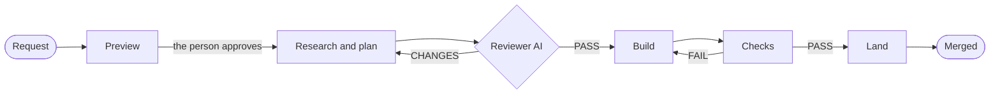

**English** | [한국어](README.ko.md)

<div align="center">

◯ ───────────────────────────────── ◯


**A K A S H A**

◯ ───────────────────────────────── ◯

**A light team harness for Claude Code and Codex.**

Each person asks for a change in plain words and approves a preview of it. That is their only step.<br>
The AI plans, another AI reviews the plan, and the AI builds, checks, and lands the change.


<a href="#license"></a>


[Quick Start](#quick-start) · [How It Works](#how-it-works) · [Many People](#many-people-at-the-same-time) · [Server Rules](#server-rules) · [Docs](docs/README.md)

</div>

```
/plugin marketplace add Gruci/akasha-team-harness
/plugin install akasha@akasha
```

* * *

## Why Akasha

Today the AI writes most of the code, and few people read it. The human check that still matters is the one at the
start: is this what we want? Akasha puts the person there, and puts machines everywhere else.

| | Without | With Akasha |
|:--|:--|:--|
| What the person checks | A technical plan, or nothing | One preview they can see: a mockup of the screen, or a diagram of the flow and the data |
| The plan | Nobody reads it, or one developer reads all of them | Another AI reviews it against the preview and the code until it passes |
| The approval | The AI can write "approved" | Only a typed "승인" (or another word of a short list) of the person approves, in the session that showed the preview, and only that version of it |
| Many people | Each person's AI works its own way, and nobody sees the others | The open pull requests are the board. Overlaps show up when a task starts and at each edit |
| "Done" | A claim | The checks of the team pass on GitHub, and the change merges as one commit with its records |
| Months later | Nobody knows why it looks like this | The preview, the plan, and the summary merge with the change |

* * *

## Quick Start

**1. The administrator — once per repository**

Install the plugin, open the repository, and say **"Set up Akasha"**. The AI asks who the administrators are, which
paths are risky, which commands check a change, what each computer needs, and which documents the AI must read. It
lines up the own agent rules of the repository with Akasha, sets up GitHub, and opens a pull request with the files.
Merge it after its checks pass.

**2. Each teammate — once**

Install the plugin, log in with `gh auth login`, and open the repository. The repository already registers the plugin
for you. If something is missing, the AI tells you what and how.

**3. Ask for a change**

```
Show the average next to the total on the fund screen.
```

The AI asks until it is clear, then opens a preview in the browser. Type **"승인"** (approve), or tell what to change.
The AI does the rest and tells you when the change is merged, and when the deployment put it live.

> **NOTE:** Python 3.11 or later (the hooks find it as `py -3`, `python3`, or `python`), git, GitHub, and the GitHub
> CLI `gh`. Codex also needs `pip install "git+https://github.com/Gruci/akasha-team-harness@v1.0.0"` in that Python.

* * *

## How It Works



| Step | Who | Gate |
|:--|:--|:--|
| 1. Request | The person says what they want | — |
| 2. Preview | The AI makes an HTML preview, the person looks at it | The person approves it in the chat |
| 3. Plan | The AI writes research and a plan | The akasha-reviewer agent passes the plan |
| 4. Build | The AI changes the code in its own work copy | The code cannot change before steps 2 and 3 |
| 5. Check | The checks of the team run | Each required check passes |
| 6. Land | The pull request gets ready, comes up to date, and merges | The checks pass on GitHub; a risky path also needs a reviewer, and the team rules an administrator |

The hooks hold the AI on these steps: they record the approval from the message of the person, record the verdict of
the reviewer agent, stop a change of the code before the gates, stop a change in the main checkout or in a work copy
outside Akasha, and stop a force push, a push to the default branch, and a merge by hand. They examine the repository
that a tool acts on, also from a session in another folder. [How it works](docs/how-it-works.md) tells each detail.

* * *

## Many People at the Same Time

| Situation | What happens |
|:--|:--|
| Two people plan the same files | The board shows the other task and its holder when a task starts |
| Two people change the same file | Each AI hears of it after the edit. The task that lands later takes the earlier change |
| Two tasks land at the same time | The first merges. Akasha brings the second up to date, and it merges after its checks pass again |
| A person stops, and someone else continues | `handoff` saves the work and frees the task; `resume` continues it on any computer. The old computer lets go of it |
| Two teams pick the same name | The second start refuses it and picks another |
| The AI is stuck | It asks the administrators on the pull request |

* * *

## Who Does What

| Who | Does | Does not have to |
|:--|:--|:--|
| **Administrator** | Sets up the repository once: the rules in `akasha.toml`, the GitHub settings | Watch each task |
| **Each person** | Says what to make, approves the preview | Read code, judge technical risk, review plans |
| **Reviewer** (optional) | Reviews a change of a risky path, for example the database | Review other changes |
| **The AI** | Plans, builds, tests, lands, and tells the result | Ask technical questions |

* * *

## Server Rules

| Repository | What stops a bad merge |
|:--|:--|
| Public, or private on GitHub Pro, Team, or Enterprise | **GitHub**: branch protection, required checks, code owners, auto-merge |
| Private on GitHub Free | **Akasha** on each computer merges only after its examination: the checks, an up-to-date branch, and the review of the owners of a risky path or of the team rules. A watch workflow reports each change that went around the rules |

The setup tries GitHub first and records which one applies, and Akasha asks GitHub again before each landing: a branch
whose protection does not require the checks of the team is never left to an auto-merge. In both cases the merge comes from the account of the person, so
the workflows after a merge start, for example a deployment. With `[deploy] workflow`, Akasha also waits for the
deployment and tells when the change is live.

* * *

## What Akasha Guarantees, and What It Does Not

| Guarantees | How |
|:--|:--|
| Only the person approves a preview | The approval comes from the hook of the message, only for a whole approval word, in the session that showed the preview, with its digest |
| The code waits for the approval and a reviewed plan | The guard stops each edit of the code before both |
| A change that failed the checks does not merge through Akasha | The landing waits for the required checks to really run and pass on GitHub |
| Each change can be found and undone | One squash commit with its summary and its records |

| Does not guarantee | Know this |
|:--|:--|
| A sandbox | The hooks keep a cooperative AI on the procedure. They do not stop a person |
| Protection on GitHub Free before a merge | A person with write access can merge by hand. The watch tells the administrators after the push |
| A merge while nobody runs Akasha on GitHub Free | A change that waits for a review merges when its holder's AI lands it again after the review |
| The business logic | The preview, the review, and the checks of the team examine it. Add a check when a problem repeats (`akasha retro`) |
| The data | Undoing code does not undo data. Put the database on the risky paths |

* * *

## More

| | |
|:--|:--|
| [How it works](docs/how-it-works.md) | The steps, the gates, the landing, and where Akasha keeps its data |
| [Set up a team](docs/admin.md) | The setup, the server rules, a team with its own CI, the retro |
| [Team config](docs/team-config.md) | Each key of `akasha.toml` |
| [Commands](docs/commands.md) | Each command of Akasha |

* * *

## Changelog

| Version | Changes |
|:--|:--|
| **v1.0.0** | First release. |

* * *

<div align="center">

*People decide what to make, once, on what they can see. The AI decides how. Each change keeps one clear record.*

## License

Daehyun Kim · [LinkedIn](https://www.linkedin.com/in/daehyun-kim-b00365176/) · MIT License

</div>
