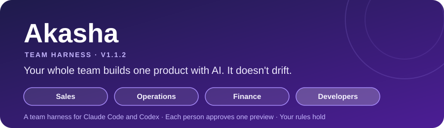
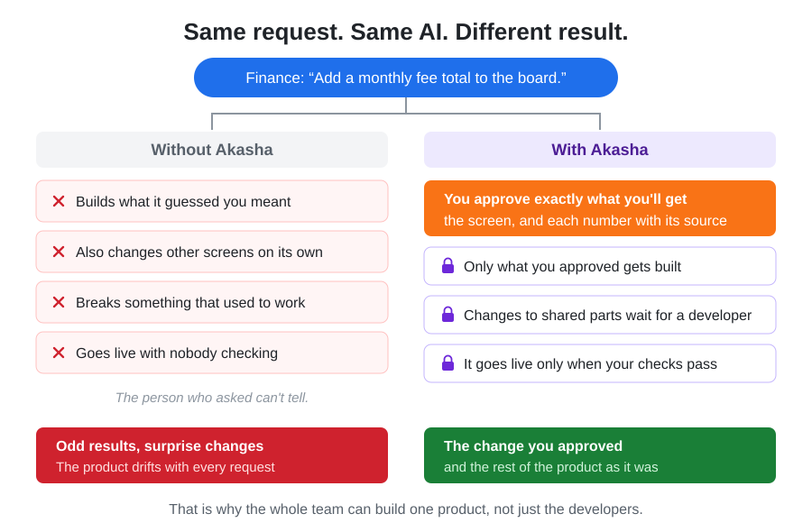
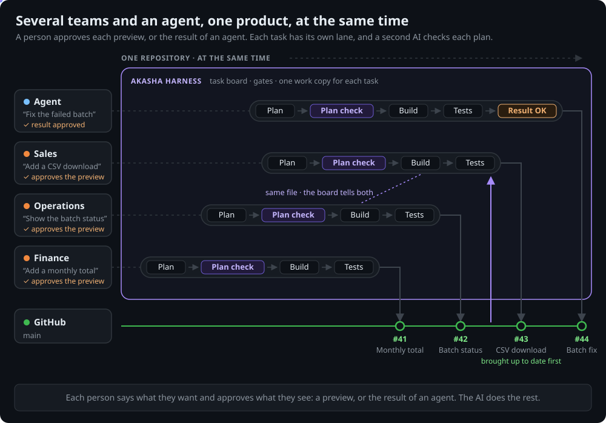

**English** | [한국어](README.ko.md)

<div align="center">



<h3>Your whole team can build with AI,<br>without the product drifting.</h3>

When people who don't code build with AI on their own, the product drifts:<br>
odd results, and changes nobody asked for.<br>
With Akasha, each person approves one preview, and only that gets built, under your team's rules.


<a href="#license"></a>


[How It Works](#how-it-works) · [How You Use It](#how-you-use-it) · [Quick Start](#quick-start) · [Many People](#many-people-at-the-same-time) · [Docs](docs/README.md)

</div>

```
/plugin marketplace add Gruci/akasha-team-harness
/plugin install akasha@akasha
```

* * *

## How It Works



Many people can do this at the same time without stepping on each other: [see how](#many-people-at-the-same-time).

* * *

## How You Use It

| 1 · Say what you want | 2 · Check the preview | 3 · It goes live |
|:--|:--|:--|
| In Claude Code or Codex, in your own words | It opens in your browser: the screen, and where each number comes from | When your team's checks pass. You get a short note of what changed |
| *"Add a monthly fee total to the board."* | *"Build it like this."* | *"Live. Monthly fee total added."* |

* * *

## Quick Start

**1. The administrator — once per repository**

Install the plugin, open the repository, and say **"Set up Akasha"**. Then the AI

- asks for the administrators, the risky parts, the check commands, what each computer needs, and the team documents
- lines up the own agent rules of the repository with Akasha
- sets up GitHub, and opens a pull request with the files. Merge it after its checks pass.

For a repository that starts now, say **"Set up Akasha for a new repository"**. The standard comes before the
first code: a structure guide with fixed rules and your answers, one list of the meanings that several screens
share, and the tests and the lint of each language as required checks.

**2. Each teammate — once**

Install the plugin, log in with `gh auth login`, and open the repository.<br>
The repository already registers the plugin. If something is missing, the AI tells you.

**3. Ask for a change**

```
Add a button that downloads the order list as a CSV file.
```

The AI asks until it is clear, then opens a preview in the browser.<br>
Approve it in your own words, in any language, or tell what to change.<br>
The AI does the rest, and tells you when the change is merged and when it is live.

> **NOTE:** Python 3.11 or later (the hooks find it as `py -3`, `python3`, or `python`), git, GitHub, and the GitHub
> CLI `gh`. Codex also needs `pip install "git+https://github.com/Gruci/akasha-team-harness@v2.0.0"` in that Python
> (on Windows `py -3 -m pip install …`).

* * *

## Under the Hood

Each task goes through six steps, and many tasks go through them at once:

| Step | Who | Gate |
|:--|:--|:--|
| 1.&nbsp;Request | The person says what they want | — |
| 2.&nbsp;Preview | The AI makes a preview: the look, the values, the rules. The person checks it | The person approves it in the chat |
| 3.&nbsp;Plan | The AI looks at the map and the code that exists, then writes the plan as a work order: steps with their files, rules, and tests | A second AI checks it until it passes. A later change of the plan or the preview needs the check again |
| 4.&nbsp;Build | The AI builds the steps in its own copy | No code before steps 2 and 3 |
| 5.&nbsp;Check | The checks of the team run, then the checks of the product: a test for each rule, the steps of the plan, the map, the rules of operation, and the sizes. Then the second AI reads the result | Each check passes, and the second AI passes the change itself |
| 6.&nbsp;Land | The pull request comes up to date and merges, in the order in which the tasks came | The checks pass on GitHub, and the records of the task hold the approval and the reviews of this version |

The hooks hold the AI on these steps.

- They keep the message of the person for the approval, and record the verdict of the second AI.
- They stop a change of the code before the gates.
- They stop a change in the main checkout, or in a work copy outside Akasha.
- They stop a force push, a push to the default branch, and a merge by hand.
- The same rules hold for a session in another folder that changes this repository or uses `git -C`.

Before the AI writes new code, `akasha start` shows it what the repository has: the guides of the team, the rules
for names, the public names of the code near the task, and the definitions that the task touches. In Claude Code
the work runs in one agent that keeps what it read from the preview to the build, and the reviews in another, so a
long task does not fill the conversation with the person.

The rules are outside the agent engine: in the commands, in two hooks of git, and on the server. An engine that
reads no instruction of Akasha still meets them, and so does a person in a terminal.

[How it works](docs/how-it-works.md) tells each detail.

* * *

## The Map of the Product

An AI starts each task without a memory. Without a map, new code goes into the nearest folder, and the same work
appears in two places. So each area of the product has a sheet, `area.toml`, in its own folder:

```toml
purpose = "Takes an order and changes its state"    # one line: what the area keeps
uses = ["catalog", "payments"]                      # the areas that its code calls
tables = ["orders", "order_items"]                  # the tables that only this area writes
```

`akasha map` joins the sheets with the code, on any computer and for any agent engine:

```
domains/orders — Takes an order and changes its state
  entry domains/orders/api.py · uses catalog, payments · 42 files · 18 public names · writes orders, order_items
domains/catalog — Keeps the products and their prices
  entry domains/catalog/api.py · uses none · 27 files · 11 public names
```

| A change | What happens |
|:--|:--|
| New code inside an area | Free |
| Code in a new folder outside each area | The check fails: it goes into the area that keeps that work |
| A new area, or one area starts to use another | The sheet changes, and an administrator approves it at the landing |
| A new public name of an entry | It needs one line that tells what it gives: the map shows that line |
| Code of one area writes a table of another | The check fails |

The check looks only at what a change makes new, so a repository with old code draws its map at any time:
`akasha map --draft` writes the first sheets from the code. Akasha reads the names and the imports of Python,
JavaScript, TypeScript, Java, Kotlin, and Go; in another language the sheets and the folders still make the map.

* * *

## Many People at the Same Time



Each person, from any team, works on their own task at the same time as the others.

| Situation | What happens |
|:--|:--|
| A new task plans the files of open tasks | The board shows those tasks and who holds them, and the AI reads what they change before it plans |
| Tasks change the same file | Each AI hears of it. Each task keeps its own pull request: the later one takes the change, and its AI resolves a conflict and checks again |
| Several tasks are ready at once | They merge one by one, in the order in which they came. Only the first one comes up to date, so a merge does not start the checks of each other task again |
| Several sessions on one computer | A task belongs to the session that works on it. Another session cannot edit it, and takes it only when the person asks |
| The records of many tasks pile up | The records of a merged task move to an archive that no work copy holds. Old records are no input of a new task, however many there are |
| A person stops, and another continues | `handoff` frees the task, `resume` continues it anywhere |
| A task name is in use | The start refuses it, and the AI picks another |
| Several sessions start on one computer | A new session asks the person about an open task that nobody works on: continue it, cancel it, or leave it |
| A task needs what only an administrator can do | The AI asks the administrators on the pull request. A question about the business goes to the person who asked |

* * *

## Who Does What

A team has three roles: the administrators, the teammates, and the agent accounts.

| Who | Does | Does not have to |
|:--|:--|:--|
| **Administrator** | Keeps the rules: Akasha, the map, the database, and the deployment. Approves a change of the structure | Review any task, or answer how to build one |
| **Teammate** | Says what to make, and approves the preview | Read code or review plans |
| **Agent account** | A program runs it, for example an operations agent: it works from the request of a person, and that person approves the result before the merge | Make a preview |

Each person keeps their own agent settings (`.claude/settings.local.json`, `CLAUDE.local.md`) out of git, so each
person can tune the harness freely.

* * *

## Server Rules

| Repository | What stops a bad merge |
|:--|:--|
| Public, or private on a paid GitHub plan | **GitHub**: branch protection and the required checks |
| Private on GitHub Free | **Akasha**: merges only after the checks pass |

- On GitHub Free, a watch workflow also reports each change that went around the rules.
- The setup tries GitHub first, and records which one applies.
- Before each landing Akasha asks GitHub again, and merges itself where the protection is weak.
- The merge comes from the account of the person, so the workflows after it start, for example a deployment.
- With `[deploy] workflow`, Akasha waits for the deployment and tells when the change is live.

* * *

## What Akasha Guarantees, and What It Does Not

| Guarantees | How |
|:--|:--|
| An approval comes from the person | Only words typed in the session that showed the preview |
| The person approves a specification, not only a picture | Akasha refuses a preview without rules, or with a value from data that has no source, formula, value, and check |
| The code waits for the approval and the plan check | The guard stops each edit of the code before both |
| A change that failed the checks does not merge | The required checks must really run and pass on GitHub |
| A change without a task, or with old evidence, does not pass | The check on GitHub reads the approval and the two reviews from the records of the task. A preview that changed after the approval fails, and so does a plan that changed after its review, or code that changed after the review of the result |
| Each rule that the person approved has a test | The check fails for a rule or a value of the preview without a test that carries its mark |
| New code is in its place | The check fails for code in a new folder outside each area, and for a new use of another area that the map does not name |
| A change stays small | The check fails for a task over the limit of size, a function over its limit, and a long file that grows |
| A copy of existing code needs a reason | A new public name with the same name or the same body as existing code fails the check, until the plan tells why it is there |
| Only an administrator changes the risky parts | A teammate's task stops at the database or the deployment |
| Each change can be found and undone | One squash commit with its summary and records |

| Does not guarantee | Know this |
|:--|:--|
| A sandbox | The hooks keep a cooperative AI on the steps |
| The meaning of an approval | The AI judges it. The pull request names who approved and when; the exact words stay on the computer of the session (`.docs/state`) |
| Who typed | The records stop evidence that is missing or old. They do not prove who the person was |
| Good design | Akasha shows the map, the code that exists, and the standard of the team, and checks what a machine can see. It does not make an AI design well |
| A product that runs | Akasha sees the lines of a change, not a server. It stops a migration that removes a column, a setting that no file names, a call without a time limit, and a silent error; the deployment, the monitoring, and the capacity are of the team |
| Protection before a merge on GitHub Free | A person can merge by hand. The watch reports it |
| The business logic | The preview, the plan check, and the checks examine it |
| The data | Undoing code does not undo data. Mark the database risky |

* * *

## More

| | |
|:--|:--|
| [How it works](docs/how-it-works.md) | The steps, the gates, the landing, and where Akasha keeps its data |
| [Set up a team](docs/admin.md) | The setup, the server rules, a team with its own CI, the retro |
| [Team config](docs/team-config.md) | Each key of `akasha.toml` |
| [Commands](docs/commands.md) | Each command of Akasha |

* * *

## Changelog

| Version | Changes |
|:--|:--|
| **v2.0.0** | Evidence on the server · the map of the product (a sheet for each area) · the checks of the product (proof, scope, map, ops, size) · the review of the result · plans as work orders · one worker agent · hooks of git · Java, Kotlin, and Go · consistency check · records archive · landing order |

Earlier versions: [Releases](https://github.com/Gruci/akasha-team-harness/releases)

* * *

<div align="center">

*People decide what to make, once, on what they can see. The AI decides how. Each change keeps one clear record.*

## License

Daehyun Kim · [LinkedIn](https://www.linkedin.com/in/daehyun-kim-b00365176/) · MIT License

</div>
