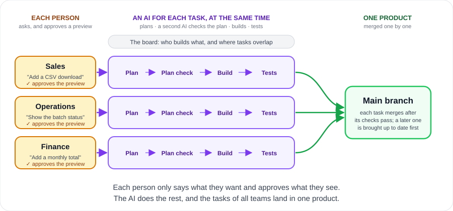

**English** | [한국어](README.ko.md)

<div align="center">

◯ ───────────────────────────────── ◯


**A K A S H A**

◯ ───────────────────────────────── ◯

**A light team harness for Claude Code and Codex.**

Each person asks for a change in plain words<br>
and approves a preview of it. That is their only step.

The AI plans, a second AI checks the plan,<br>
and the AI builds, checks, and lands the change.


<a href="#license"></a>


[Quick Start](#quick-start) · [How It Works](#how-it-works) · [Many People](#many-people-at-the-same-time) · [Server Rules](#server-rules) · [Docs](docs/README.md)

</div>

```
/plugin marketplace add Gruci/akasha-team-harness
/plugin install akasha@akasha
```

* * *

## Why Akasha

Today the AI writes most of the code, and few people read it.<br>
The human check that still matters is the one at the start: is this what we want?<br>
Akasha puts the person there, and puts machines everywhere else.

| | Without | With Akasha |
|:--|:--|:--|
| What the person checks | A technical plan, or nothing | A preview they can see: a mockup or a diagram |
| The plan | Nobody reads it | A second AI checks it until it passes |
| The approval | The AI can write "approved" | Only words that the person typed, kept as typed |
| Many people | Nobody sees the others | The open pull requests are the board |
| "Done" | A claim | The checks pass on GitHub, then one commit |
| Months later | Nobody knows why | The preview, plan, and summary stay with it |

* * *

## Quick Start

**1. The administrator — once per repository**

Install the plugin, open the repository, and say **"Set up Akasha"**. Then the AI

- asks for the administrators, the risky paths, the check commands, what each computer needs, and the team documents
- lines up the own agent rules of the repository with Akasha
- sets up GitHub, and opens a pull request with the files. Merge it after its checks pass.

**2. Each teammate — once**

Install the plugin, log in with `gh auth login`, and open the repository.<br>
The repository already registers the plugin. If something is missing, the AI tells you.

**3. Ask for a change**

```
Add a button that downloads the order list as a CSV file.
```

The AI asks until it is clear, then opens a preview in the browser.<br>
Approve it in your own words, in any language, or tell what to change.<br>
The AI does the rest, and tells you when the change is merged and when it is live.

> **NOTE:** Python 3.11 or later (the hooks find it as `py -3`, `python3`, or `python`), git, GitHub, and the GitHub
> CLI `gh`. Codex also needs `pip install "git+https://github.com/Gruci/akasha-team-harness@v1.0.0"` in that Python
> (on Windows `py -3 -m pip install …`).

* * *

## How It Works



Each task goes through six steps, and many tasks go through them at once:

| Step | Who | Gate |
|:--|:--|:--|
| 1.&nbsp;Request | The person says what they want | — |
| 2.&nbsp;Preview | The AI makes a preview, the person looks | The person approves it in the chat |
| 3.&nbsp;Plan | The AI writes research and a plan | A second AI checks it until it passes |
| 4.&nbsp;Build | The AI changes the code in its own copy | No code before steps 2 and 3 |
| 5.&nbsp;Check | The checks of the team run | Each required check passes |
| 6.&nbsp;Land | The pull request comes up to date and merges | The checks pass on GitHub |

The hooks hold the AI on these steps.

- They keep the message of the person for the approval, and record the verdict of the second AI.
- They stop a change of the code before the gates.
- They stop a change in the main checkout, or in a work copy outside Akasha.
- They stop a force push, a push to the default branch, and a merge by hand.
- The same rules hold for a session in another folder that changes this repository or uses `git -C`.

[How it works](docs/how-it-works.md) tells each detail.

* * *

## Many People at the Same Time

Each person, from any team, works on their own task at the same time as the others.

| Situation | What happens |
|:--|:--|
| A new task plans the files of open tasks | The board shows those tasks and who holds them |
| Tasks change the same file | Each AI hears of it, and the later task takes the change |
| Several tasks are ready at once | They merge one by one, each up to date first |
| A person stops, and another continues | `handoff` frees the task, `resume` continues it anywhere |
| A task name is in use | The start refuses it, and the AI picks another |
| The AI is stuck | It asks the administrators on the pull request |

* * *

## Who Does What

A team has two roles: the administrators, and the teammates.

| Who | Does | Does not have to |
|:--|:--|:--|
| **Administrator** | Sets up the repository once, and looks at risky changes | Watch each task |
| **Teammate** | Says what to make, and approves the preview | Read code or review plans |

* * *

## Server Rules

| Repository | What stops a bad merge |
|:--|:--|
| Public, or private on a paid GitHub plan | **GitHub**: branch protection, required checks, code owners |
| Private on GitHub Free | **Akasha**: merges only after the checks and the reviews pass |

- On GitHub Free, a watch workflow also reports each change that went around the rules.
- The setup tries GitHub first, and records which one applies.
- Before each landing Akasha asks GitHub again, and merges itself where the protection is weak.
- The merge comes from the account of the person, so the workflows after it start, for example a deployment.
- With `[deploy] workflow`, Akasha waits for the deployment and tells when the change is live.

* * *

## What Akasha Guarantees, and What It Does Not

| Guarantees | How |
|:--|:--|
| An approval comes from the person | Only words typed in the session that showed the preview |
| The code waits for the approval and the plan check | The guard stops each edit of the code before both |
| A change that failed the checks does not merge | The required checks must really run and pass on GitHub |
| A risky change merges as the administrator saw it | A later change of a risky file needs a new look |
| Each change can be found and undone | One squash commit with its summary and records |

| Does not guarantee | Know this |
|:--|:--|
| A sandbox | The hooks keep a cooperative AI on the steps |
| The meaning of an approval | The AI judges it. The pull request shows the exact words |
| Protection before a merge on GitHub Free | A person can merge by hand. The watch reports it |
| A merge on GitHub Free while nobody lands | A reviewed change merges when its AI lands it again |
| The business logic | The preview, the plan check, and the checks examine it |
| The data | Undoing code does not undo data. Mark the database risky |

* * *

## More

| | |
|:--|:--|
| [How it works](docs/how-it-works.md) | The steps, the gates, the landing, and where Akasha keeps its data |
| [Set up a team](docs/admin.md) | The setup, the server rules, a team with its own CI, the retro |
| [Team config](docs/team-config.md) | Each key of `akasha.toml` |
| [Commands](docs/commands.md) | Each command of Akasha |

* * *

## Changelog

| Version | Changes |
|:--|:--|
| **v1.0.0** | First release. |

* * *

<div align="center">

*People decide what to make, once, on what they can see. The AI decides how. Each change keeps one clear record.*

## License

Daehyun Kim · [LinkedIn](https://www.linkedin.com/in/daehyun-kim-b00365176/) · MIT License

</div>
