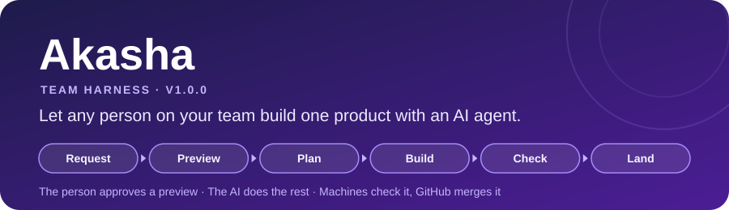
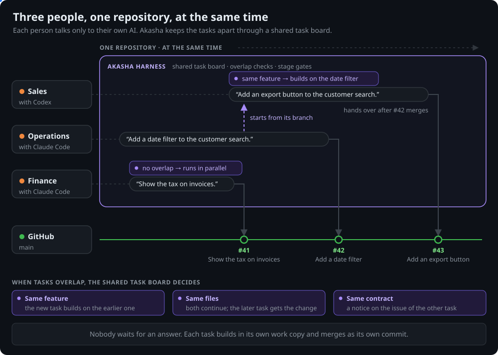
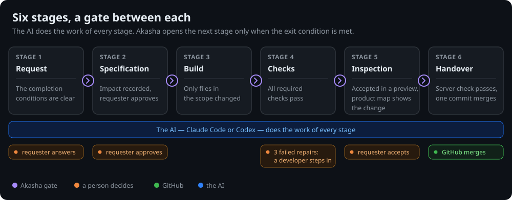

**English** | [한국어](README.ko.md)

<div align="center">

◯ ───────────────────────────────── ◯



**A K A S H A**

◯ ───────────────────────────────── ◯

**A team harness for Claude Code and Codex.**

Anyone on the team asks for a feature in plain words. The AI asks, builds, and makes the technical calls —<br>
Akasha keeps it on one procedure until the change merges as one checked, accepted commit.


<a href="#license"></a>


[Quick Start](#quick-start) · [Why](#why-akasha) · [How It Works](#how-it-works) · [Who Does What](#who-does-what) · [Server Rules](#server-rules) · [Docs](docs/README.md)

</div>

```
/plugin marketplace add Gruci/akasha-team-harness
/plugin install akasha@akasha
```

* * *

## Why Akasha

Akasha is not another agent. It runs inside the AI you already use: skills give it the team procedure, hooks stop what breaks the procedure, and stage gates hold a task until it passes.

| | Without | With Akasha |
|:--|:--|:--|
| Team rules | Each person's AI works its own way | The administrator writes them once in `akasha.toml`.<br>Every AI on the team and the server check follow them |
| A vague request | The AI builds something else | The AI asks until the completion conditions are clear.<br>The task does not move before that |
| Technical calls | Only a developer can judge them | The AI makes them and records them.<br>People decide what to make, how it looks, and how it is used |
| Side effects | Nobody sees what else the change touches | The AI records the effect on features, data, APIs, and other tasks,<br>and how to reverse it |
| "Done" | A claim | The requester tries it in a preview<br>and accepts each condition |
| Months later | Nobody can find the change that broke it | One squash commit per change,<br>with a one-minute briefing |
| Two people, one feature | One waits for the other | The second task builds on the first |

* * *

## Quick Start

**1. Administrator — once per repository**

Install the plugin, open the repository, and say **"Set up Akasha."**

```
/plugin marketplace add Gruci/akasha-team-harness
/plugin install akasha@akasha
```

The AI asks for:

- the administrators of the team rules
- the high-risk folders, and who must approve a change in them
- the commands that install, test, and preview the project

Then approve the GitHub settings. The AI turns on the server rules for the whole team and opens a pull request with the setup files. Merge it.

**2. Each person — once**

Install the same plugin and open the team repository. At session start, the Akasha hook checks the repository and tells the AI what it found:

| The hook finds | What happens |
|:--|:--|
| Not set up yet | The AI offers the setup of step 1 |
| Server rules off | The AI tells you. An administrator approves once, and the AI turns them on.<br>Work can start now. Only the handover waits |
| Ready | The AI starts work. No setup |

**3. Ask for a feature**

```
Add a date filter to the customer search.
```

> **NOTE:** Needs Python 3.11+, git, and GitHub. Codex also needs `pip install "git+https://github.com/Gruci/akasha-team-harness@v1.0.0"`.

* * *

## What You Get

<p align="center"></p>

An administrator set up the repository once. Then three people ask for changes on the same afternoon. Each person talks only to their own AI. None of them is a developer.

| Who | Asks | The shared task board |
|:--|:--|:--|
| Operations,<br>with Claude Code | "Add a date filter to the customer search." | A new task with its own work copy |
| Finance,<br>with Claude Code | "Show the tax on invoices." | No overlap with the date filter,<br>so both run in parallel |
| Sales, with Codex,<br>a bit later | "Add an export button to the customer search." | The same feature as the date filter.<br>The task starts from that branch,<br>and hands over after the date filter merges |

GitHub merges three commits in order — `#41 Show the tax on invoices`, `#42 Add a date filter`, `#43 Add an export button` — each with its own briefing. Nobody waited for an answer from another person.

When two tasks overlap, the board decides:

| Overlap | What happens |
|:--|:--|
| Same feature | The new task builds on the earlier one |
| Same files | The earlier task merges first |
| Same contract | A notice goes on the issue of the other task,<br>and GitHub tells the people who follow it |

Each task also gets its own issue on the board, its own preview port, and its own preview database.

* * *

## How It Works

<p align="center"></p>

| Stage | Exit condition | Who besides the AI |
|:--|:--|:--|
| Before the first task | The team rules are in `akasha.toml`.<br>The server rules are on before the first handover | The administrator, once |
| 1. Request | The completion conditions are clear | The requester answers the questions |
| 2. Specification | The impact is recorded.<br>The requester approves | The requester approves |
| 3. Build | Only files in the scope changed | — |
| 4. Checks | All required checks pass | A developer,<br>after three failed repairs |
| 5. Inspection | The requester accepts in a preview.<br>The product map shows the change | The requester accepts |
| 6. Handover | The server check passes.<br>One commit merges with the briefing | GitHub merges |

Small changes use the `small` workflow, defects the `fix` workflow.

| Layer | Enforced by |
|:--|:--|
| While working | Hooks check every command and saved file.<br>They stop what cannot be undone, like a force push |
| Before handover | The exit conditions,<br>including a check of the briefing |
| On the server | The required check `akasha`, with the rules of the default branch.<br>A pull request cannot loosen its own rules |

* * *

## Who Does What

| Who | Does | Never has to |
|:--|:--|:--|
| **Administrator** | Sets up the repository once: the team rules in `akasha.toml`.<br>Approves changes of the GitHub settings | Configure each setting by hand |
| **Requester** — anyone on the team | Says what to make, how it looks, and how it is used.<br>Tries the preview | Read code or judge technical risk |
| **The AI** — Claude Code or Codex | Implementation, scope, impact, and tests.<br>The briefing and the product map | Ask people technical questions |

* * *

## Server Rules

GitHub's own protection comes first. Akasha's helper workflows fill in only where the GitHub plan has none.

| Repository | Enforced by |
|:--|:--|
| Public, or private on<br>GitHub Pro, Team, or Enterprise | **GitHub** — branch protection, the required check,<br>code owners, and auto-merge |
| Private on GitHub Free | **Akasha's helpers** — `akasha-merge` merges after the check passes.<br>`akasha-watch` reverts a change that skipped the check, and opens an issue |

Setup tries GitHub first and records which one applies in `akasha.toml`. After a plan change, run setup again.

> **NOTE:** GitHub stops a bad change before it merges. `akasha-watch` reverts it right after. Administrator pushes and force pushes are reported, not reverted.

* * *

## What It Guarantees — and What It Does Not

| Guaranteed | How |
|:--|:--|
| The team rules do not change without an administrator | CODEOWNERS |
| Nothing merges with a failed required check | The server rules. Setup installs them,<br>and each session start checks them again |
| Nothing the requester did not accept reaches a pull request | `feature` and `fix` need the acceptance record<br>to hand over |
| Every change can be found and reverted | One squash commit per task, with its briefing |
| Tasks do not overwrite each other | One work copy per task.<br>Tasks of the same feature stack |

| Not guaranteed | What to know |
|:--|:--|
| A preview environment | Your project provides it. The administrator gives the command at setup,<br>and the AI starts it |
| A security boundary | Hooks keep a cooperating AI on the rules.<br>They are not a sandbox |
| Correct business logic | That is what the inspection is for |
| Data rollback | Reverting code does not restore data.<br>The impact record says how to reverse it |

* * *

## FAQ

| Question | Answer |
|:--|:--|
| Who can set up Akasha? | Anyone can say "Set up Akasha."<br>Only an administrator can approve the GitHub settings |
| A private repository on GitHub Free? | Yes. See [Server Rules](#server-rules) |
| A team with no developer? | Yes. The AI makes the technical calls, and the server check stops a failing change.<br>A team with developers can add a person gate for data or permissions |
| Does the requester need a terminal? | No. They ask in the desktop app.<br>The AI runs the commands |
| Two people change the same feature? | The second task builds on the first.<br>If it changes behavior that the first requester accepted,<br>Akasha leaves that person a notice on GitHub |
| How do I revert a change? | Find its commit on the default branch, and read the briefing.<br>Then revert that one commit |

* * *

## Details

You do not need these to get started — the AI handles them.

<details>
<summary><b>Under the hood — eight parts in four areas</b></summary>

| Area | Part | Function |
|:--|:--|:--|
| Work procedure | Core | Task state, stage moves, and the pull request briefing |
| Work procedure | Workflow | The stages and exit conditions of `feature`, `fix`, and `small` |
| Work procedure | Skills and context | The procedures, the product map, and the decisions of your team |
| Work procedure | Validators | Each rule that a machine can examine, as a check |
| Work procedure | Team config | The team rules in `akasha.toml` |
| Agent engine | Agent engine | Loads the hooks and skills into Claude Code or Codex |
| Coordination | Coordinator | The shared task board, overlap checks, and stacked tasks |
| Infrastructure control | Infrastructure manager | Keeps the server rules the same as the team config |

```
akasha/
├── core/          task state, stages, risk, work copies, pull request text
├── workflows/     feature · fix · small
├── validators/    guard, secret check, check runner, briefing check, language packs
├── coordinator/   shared task board, overlap checks, preview resources
├── infra/         GitHub settings, merge and watch helpers, workflow templates
└── engine/        hooks for Claude Code and Codex
skills/            akasha-setup · akasha-request · akasha-inspect · akasha-handover
```

</details>

* * *

## Changelog

| Version | Changes |
|:--|:--|
| **v1.0.0** | First public release. |

* * *

<div align="center">

*People decide what to make. The AI decides how. Each change leaves one clear record.*

## License

Daehyun Kim · [LinkedIn](https://www.linkedin.com/in/daehyun-kim-b00365176/) · MIT License

</div>
