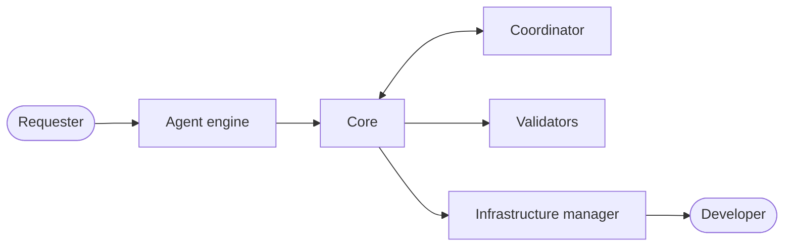

# Architecture

This document tells how the parts of Akasha connect, where Akasha keeps its data, and which commands the agent engine runs.

## Four areas and eight parts

| Area | Part | Location | Function |
|:--|:--|:--|:--|
| Team harness | Core | `akasha/core/`, `akasha/flow.py` | Keeps the state of each task, moves the task between stages, and writes the handover document |
| Team harness | Workflow | `akasha/workflows/`, `.akasha/workflows/` | Declares the stages and the exit conditions |
| Team harness | Skills and context | `skills/`, `.akasha/context/` | Give the procedures to the agent engine, and give it the decisions and lessons of your team |
| Team harness | Validators | `akasha/validators/` | Change each rule that a machine can examine into a check |
| Team harness | Team config | `akasha.toml`, `akasha/config.py` | Holds the team rules for one repository |
| Agent engine | Agent engine | `akasha/engine/`, `.claude-plugin/` | Connects Claude Code and Codex to Akasha with hooks, skills, and session rules |
| Coordination | Coordinator | `akasha/coordinator/` | Keeps the shared task board, finds overlaps, and gives each preview its own resources |
| Infrastructure control | Infrastructure manager | `akasha/infra/` | Keeps the required check, branch protection, and CODEOWNERS the same as the team config |

The core is the same in all teams. A team changes the workflows, the skills and context, and the team config.

## The path of one task

1. The requester tells the goal to the agent engine.
2. The agent engine records the task. The core writes the task file.
3. The coordinator compares the task with the tasks of all requesters on the shared task board.
4. The agent engine asks questions until the completion conditions are clear. The core records them.
5. The core sets the risk level from the scope and the risk rules.
6. After the approvals, the core makes a work copy. The agent engine builds the change in it.
7. The validators run the required checks in the work copy.
8. The requester examines the result in a preview and accepts it.
9. The core writes the handover document. Akasha opens the pull request.
10. The infrastructure manager makes sure that the server rules are on. A developer reviews and merges.

## Where Akasha keeps its data

| Data | Location | In git |
|:--|:--|:--|
| Team rules | `akasha.toml` | Yes |
| Team workflows | `.akasha/workflows/*.toml` | Yes |
| Team context | `.akasha/context/*.md` | Yes |
| Server rules | `.github/workflows/akasha.yml`, `.github/CODEOWNERS`, `.github/pull_request_template.md` | Yes |
| Branch protection | The GitHub settings of the default branch | No |
| Shared task board | GitHub issues with the label `akasha` | No |
| Task state | `.akasha/state/tasks/<task>.json` | No |
| Work copies | `.akasha/work/<task>/`, on the branch `akasha/<task>` | No |

## Three enforcement layers

| Layer | When | What enforces it |
|:--|:--|:--|
| During the work | Before each command and edit, after each edit, and at the end of each turn | The hooks of the agent engine |
| Before the handover | When a task tries to go to the next stage | The exit conditions of the workflow |
| On the server | Before each merge | The required check `akasha`, branch protection, and CODEOWNERS |

> **CAUTION:** The first two layers keep a cooperative agent engine on the rules. They are not a sandbox. Only a person with administrator rights can go around the server layer.

## The command line

The agent engine runs these commands. People do not have to remember them. The session start notice gives the full command.

| Command | Function |
|:--|:--|
| `setup` | Writes `akasha.toml` and the files that Codex reads. With the approval of an administrator, it also changes the GitHub settings |
| `request` | Records a new task and shows overlaps |
| `specify` | Adds completion conditions, open questions, or file patterns of the scope |
| `approve` | Records the approval of a requester, a developer, or an administrator |
| `advance` | Moves the task to the next stage, or shows what blocks it |
| `show` | Shows one task: stage, risk, scope, conditions, approvals, checks, and preview values |
| `check` | Runs the required checks in the work copy |
| `accept` | Records the inspection of the requester |
| `handover` | Checks the change again on the latest default branch, pushes it, and opens the pull request |
| `resume` | Opens a stopped task again after a developer examined it |
| `cancel` | Stops a task for good |
| `board` | Shows the tasks of all requesters |
| `infra` | Shows the GitHub settings that are not correct. With `--apply`, it corrects them |
| `hook` | The entry point for the hooks of the agent engine |

## Requirements

- Python 3.11 or later, and git.
- The GitHub command line `gh`, logged in. Akasha uses it for the shared task board, the pull request, and the server rules.

> **NOTE:** Without GitHub, the shared task board holds only the tasks on one computer, and the handover cannot open a pull request.
