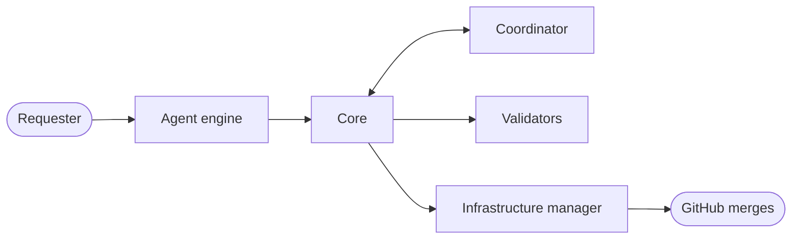

# Architecture

This document tells how the parts of Akasha connect, where Akasha keeps its data, and which commands the agent engine runs.

## The principle

People decide what to make, how it looks, and how people use it. The agent engine makes the technical decisions: the implementation, the scope, the impact on other features and data, and the order of the work between tasks. Akasha makes the agent engine record each decision, checks the result, and merges it as one commit that a person can find and revert.

## Four areas and eight parts

| Area | Part | Location | Function |
|:--|:--|:--|:--|
| Work procedure | Core | `akasha/core/`, `akasha/flow.py` | Keeps the state of each task, moves the task between stages, and writes the pull request text |
| Work procedure | Workflow | `akasha/workflows/`, `.akasha/workflows/` | Declares the stages and the exit conditions |
| Work procedure | Skills and context | `skills/`, `.akasha/context/` | Give the procedures to the agent engine, and give it the product map and the decisions of your team |
| Work procedure | Validators | `akasha/validators/` | Change each rule that a machine can examine into a check |
| Work procedure | Team config | `akasha.toml`, `akasha/config.py` | Holds the team rules for one repository |
| Agent engine | Agent engine | `akasha/engine/`, `.claude-plugin/` | Connects Claude Code and Codex to Akasha with hooks, skills, and session rules |
| Coordination | Coordinator | `akasha/coordinator/` | Keeps the shared task board, finds overlaps, stacks tasks of one feature, and gives each preview its own resources |
| Infrastructure control | Infrastructure manager | `akasha/infra/` | Keeps the required check, branch protection, auto-merge, and CODEOWNERS the same as the team config |

The core is the same in all teams. A team changes the workflows, the skills and context, and the team config.

## The path of one task

1. The requester tells the agent engine what to make.
2. The agent engine records the task. The coordinator compares it with the tasks of all requesters.
3. The agent engine asks questions until the completion conditions are clear.
4. The agent engine reads the product map, finds the effects of the change, and records the impact analysis.
5. The requester approves the specification in simple words.
6. The core makes a work copy. The agent engine builds the change and a test for each completion condition.
7. The validators run the required checks. When all checks pass, Akasha saves the work and pushes the task branch.
8. The requester examines the result in a preview and accepts it.
9. The agent engine updates the product map and writes the briefing.
10. Akasha opens the pull request and turns on auto-merge. GitHub merges it as one squash commit when the server check passes.

## Where Akasha keeps its data

| Data | Location | In git |
|:--|:--|:--|
| Team rules | `akasha.toml` | Yes |
| Team workflows | `.akasha/workflows/*.toml` | Yes |
| Product map and team context | `.akasha/context/*.md` | Yes |
| Server files | `.github/workflows/akasha.yml`, `akasha-merge.yml`, `akasha-watch.yml`, the Akasha block of CODEOWNERS, `.github/pull_request_template.md` | Yes |
| Branch protection and repository settings | GitHub | No |
| Shared task board | GitHub issues with the label `akasha` | No |
| Task state | `.akasha/state/tasks/<task>.json` | No |
| Work copies | `.akasha/work/<task>/`, on the branch `akasha/<task>` | No |

## Three enforcement layers

| Layer | When | What enforces it |
|:--|:--|:--|
| During the work | Before each command and edit, after each edit, and at the end of each turn | The hooks of the agent engine |
| Before the handover | When a task tries to go to the next stage | The exit conditions of the workflow |
| On the server | Before each merge | The required check `akasha`. GitHub branch protection and CODEOWNERS enforce it. Where the GitHub plan has no protection, the helpers of Akasha enforce it |

> **CAUTION:** The first two layers keep a cooperative agent engine on the rules. They are not a sandbox. Only a person with administrator rights can go around the server layer.

## The command line

The agent engine runs these commands. People do not have to remember them. The session start notice gives the full command.

| Command | Function |
|:--|:--|
| `setup` | Writes `akasha.toml`, the product map, and the files that Codex reads. With the approval of an administrator, it also changes the GitHub settings |
| `request` | Records a new task and shows overlaps. `--builds-on` stacks it on an earlier task |
| `specify` | Adds completion conditions, open questions, or file patterns of the scope |
| `impact` | Records the impact analysis, a reason why the product map does not change, or a change of behavior that an earlier requester accepted |
| `approve` | Records the approval of a requester or of a gate role |
| `advance` | Moves the task to the next stage, or shows what blocks it |
| `show` | Shows one task: stage, risk, scope, conditions, impact, approvals, checks, and preview values |
| `check` | Runs the required checks in the work copy |
| `accept` | Records the inspection of the requester |
| `brief` | Examines and records the briefing |
| `handover` | Checks the change again on the latest default branch, opens the pull request, and turns on auto-merge |
| `resume` | Opens a stopped task again after a developer examined it |
| `cancel` | Stops a task for good |
| `board` | Shows the tasks of all requesters |
| `infra` | Shows the GitHub settings that are not correct. With `--apply`, it corrects them |
| `hook` | The entry point for the hooks of the agent engine |
| `server` | The merge and watch helpers run this on GitHub. People and the agent engine do not run it |

## Requirements

- Python 3.11 or later, and git.
- The GitHub command line `gh`, logged in with an account that can write to the repository.
- The git remote `origin` is the team repository on GitHub, not a fork. Akasha gives `gh` the repository of `origin`, so that the branches, the issues, and the pull requests go to the same repository.

> **NOTE:** Without GitHub, the shared task board holds only the tasks on one computer, and the handover cannot open a pull request. When `origin` is on GitHub and `gh` cannot read or write the board, the commands stop.
